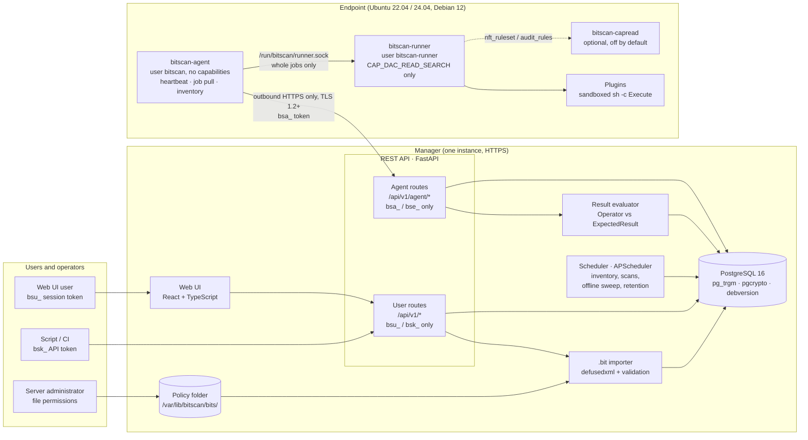

# Vulnerability & Compliance Platform — Technical Specification

Oct 19, 2026 · @Jason Liang

## 1. Overview

The platform (working name **Bitscan**) is a manager + agent system that inventories Ubuntu/Debian Linux endpoints and runs compliance checks defined in `.bit` policy files. It is inspired by Nessus but is agent-only, Linux-only and compliance-first.

### 1.1 Functional

| ID | Goal |
| --- | --- |
| G1 | A `.deb` agent installs on Ubuntu/Debian, registers with the manager, heartbeats every 5 minutes, and pulls its compliance jobs from the job queue on a fixed interval. The manager never pushes commands. |
| G2 | The manager collects `os_info` and the full `dpkg` package list from every agent on a fixed schedule. This collection is mandatory and cannot be disabled by any user, role or API call. |
| G3 | Package inventory is searchable across the whole fleet (by name, version, architecture, host). |
| G4 | Compliance profiles come from `.bit` files. One `<Policy>` = one selectable profile. |
| G5 | `.bit` files load into the internal database automatically, and can be re-imported manually to rebuild a corrupted database. |
| G6 | Users can schedule compliance scans or trigger them manually per host, group or fleet. |

### 1.2 Out of scope (v1)

- Network/remote (agentless) scanning, Windows or macOS endpoints.
- CVE vulnerability matching against packages (the inventory is designed so it can be added in v2, see §7.4).
- Automatic remediation. Plugins only read and report state.
- A signed APT repository for the agent package. v1 ships the `.deb` file with a published SHA-256.

### 1.3 Terminology

| Term | Meaning |
| --- | --- |
| Manager | Central server: API, web UI, scheduler, database. |
| Agent | The `bitscan-agent` and `bitscan-runner` services installed from a `.deb` on each endpoint. |
| `.bit` file | XML file defining one compliance Policy, its Family (standard) and its Plugins (checks). |
| Policy / Profile | A `<Policy>`; shown in the UI as a compliance profile. |
| Family | The standard a policy implements, e.g. `CIS Ubuntu 24.04`, `Clustermax`. |
| Plugin | One check = one line item in the standard, with the shell command to run. |
| Job | A unit of work the manager queues for an agent (inventory collection or compliance scan). |

### 1.4 Confirmed decisions

- **Plugin display name.** Plugins are shown as `<family name> - <plugin name>`, e.g. `CIS Ubuntu 24.04 - 1.3.1.1 - Ensure AppArmor is installed`.
- **Pass/fail rule.** The manager compares the `<Execute>` output with `<ExpectedResult>` using `<Operator>`; the comparison returns `0` = PASS, `1` = FAIL, anything else = ERROR (§4.5).
- **Tag names.** The sample tags contained spaces and mismatched case, which is not valid XML. The parser uses the canonical form (`<PolicyName>`, `<PluginsGroups>` …) defined in the companion *.bit File Format & Schema Reference*.

## 2. System Architecture

The manager is a single deployable service backed by PostgreSQL; agents are pull-based and never accept inbound connections.



*Figure 1. System architecture: manager components and the agent. Every arrow into the manager is an outbound HTTPS call from its caller; the agent accepts no inbound connections.*

Agents poll the API; the scheduler writes jobs to the database; the evaluator scores results as they arrive.

### 2.1 Components

| Component | Responsibility | Tech |
| --- | --- | --- |
| Web UI | Profiles, hosts, scans, results, package search | React + TypeScript |
| REST API | User routes (`bsu_`/`bsk_` tokens) and agent routes under `/api/v1/agent/` (`bsa_`/`bse_` tokens), all over HTTPS | Python 3.12, FastAPI, Pydantic v2 |
| Scheduler | Inventory jobs (system job), scheduled scans, offline sweep, retention | APScheduler, inside the manager process (one manager instance in v1) |
| `.bit` importer | Parse, validate, upsert policies; rebuild | `defusedxml` + rule-based validation |
| Result evaluator | Compare stdout with ExpectedResult using the Operator (§4.5), compute scores | In the API process, on result arrival |
| Database | Single source of truth | PostgreSQL 16 (`pg_trgm`, `debversion`) |
| Agent | Heartbeat, job pull, inventory; runner executes plugins | Go (a currently supported release), static binaries, `.deb`, systemd |

### 2.2 Design principles

- **Pull, not push.** Agents initiate every connection, so endpoints need no open inbound port. Commands are never pushed: the agent pulls its job queue on a fixed interval, and the heartbeat only reports status. Agent and user traffic is TLS/HTTPS; the only certificate is the manager's server certificate, and agents prove who they are with a token, not a certificate.
- **Idempotent jobs.** Every job has a UUID; re-delivery never produces duplicate results (first result per plugin wins).
- **Catalog is rebuildable.** Policy tables are derived from `.bit` files and can be rebuilt from them at any time without touching hosts, inventory or scan history (§4.2).
- **Immutable results.** Scan results snapshot the plugin name, command, Operator, ExpectedResult and policy version at run time. Re-evaluation adds rows; it never changes them.

### 2.3 Data flows and tokens

Every call into the manager carries a bearer token over HTTPS (TLS 1.2+). User tokens work only on user routes and agent tokens only on `/api/v1/agent/` routes. Steps inside the manager use database credentials, never a user or agent token.

| Token | Used by | Expiry |
| --- | --- | --- |
| `bsu_` session token | Web UI user | 8 h idle, 24 h max |
| `bsk_` API token | Scripts / CI | Default 90 days, max 365; revocable; never allowed for sensitive actions (§6.2) |
| `bse_` enrolment token | New agent, once at install | Default 24 h; `max_uses` 1–10,000; optional source CIDRs |
| `bsa_` agent token | Enrolled agent | Default 365 days (60–730); rotated by the agent inside a fixed window (§3.2) |

**Compliance scan flow**

| # | From → To | What happens | Credential |
| --- | --- | --- | --- |
| 0 | Admin → importer → database | An admin uploads a `.bit` file, or a server administrator copies it into the policy folder; it is parsed, validated and live immediately (§4.1) | Admin `bsu_` or `bsk_` token, or server file permissions |
| 1 | User → web UI → API | User picks a profile and hosts, clicks Run scan | `bsu_` session token |
| 2 | API → database | Role checked; one job per host is built from the policy's current plugins | DB role inside the manager |
| 3 | Agent → API | Agent pulls its jobs every `job_pull_seconds` and receives the commands and redaction patterns | `bsa_` agent token over TLS |
| 4 | On the endpoint | Agent and runner check the job is for this host, before its deadline and not already run; the runner runs each `Execute` in the sandbox and redacts the output | Local checks (§3.3) |
| 5 | Agent → API | Returns redacted stdout, stderr and exit code in batches | `bsa_` agent token |
| 6 | API → database | Each result is evaluated against the job's `eval_spec` and stored with its verdict in one insert | DB role |
| 7 | Web UI → API → user | User views results and compliance score; raw output only for operator and admin | `bsu_` session token |

**Flows running alongside, on their own timers**

| # | From → To | What happens | Credential |
| --- | --- | --- | --- |
| A | Agent → API, every 5 min | Heartbeat: status in, configuration (`job_pull_seconds`) out; never commands | `bsa_` agent token |
| B | Scheduler → agent via job pull, every 6 h (cannot be turned off); also after dpkg changes | Inventory: `os_info` and `dpkg` package list | `bsa_` agent token |
| C | New agent → API, once at install | Enrolment: swaps the enrolment token for its own `bsa_` token; held for admin approval unless the enrolment token allows auto-approval | `bse_` enrolment token |
| D | Script / CI → API | Same user routes as the web UI, except sensitive actions | `bsk_` API token |
| E | Agent → API, inside the rotation window | Token rotation; old token valid 10 more minutes | `bsa_` agent token |

## 3. Agent (`bitscan-agent`)

The agent is one `.deb`, `bitscan-agent_<version>_<arch>.deb` (amd64, arm64), for Ubuntu 22.04/24.04 and Debian 12. Hosts must use the unified cgroup v2 hierarchy, the default on these releases; on any other setup the runner refuses to start and the agent reports `runner_unavailable`. It contains two static binaries, `bitscan-agent` (network-facing, unprivileged) and `bitscan-runner` (runs plugins), plus the optional `bitscan-capread` helper (§3.7).

### 3.1 Packaging and install

| Item | Value |
| --- | --- |
| Binaries | `/usr/sbin/bitscan-agent`, `/usr/sbin/bitscan-runner`, `/usr/sbin/bitscan-capread` |
| Units | `bitscan-agent.service`, `bitscan-runner.socket`, `bitscan-runner.service`; `bitscan-capread.socket` and `.service` are installed but disabled. Installed with `dh_installsystemd`; `--no-enable` for `bitscan-runner.service` (started by its socket), and `--no-enable --no-start` for the capread units, so they stay off until enabled on the host. |
| Config | `/etc/bitscan/agent.yaml` (`root:bitscan`, 0640); written only by `postinst` or root, never by the agent |
| D-Bus policy | `/etc/dbus-1/system.d/bitscan-runner.conf` (§3.7) |
| State | `/var/lib/bitscan-agent/` (`bitscan:bitscan`, 0700): `agent_id`, `token`, `enroll.token` (until enrolled), result spool, seen job ids |
| Logs | journald; plugin output and tokens are never logged |
| Install inputs | debconf questions, preseedable: `bitscan/manager_url`, `bitscan/enrol_token`, and optionally `bitscan/ca_file` and `bitscan/manager_spki_sha256`. `bitscan/enrol_token` is a `password`-type question, so debconf keeps it only in its root-only `passwords.dat`, and `postinst` clears it after use. Alternatively a root-only file `/etc/bitscan/install.env` (0600) that `postinst` reads and then deletes. Never command-line environment variables, which end up in shell history and process lists. |
| Install | Check the file with `sha256sum -c` against the SHA-256 on the release page, which is served from a different origin than the download. Then `sudo debconf-set-selections bitscan.preseed && sudo apt install ./bitscan-agent_<version>_<arch>.deb`, and delete the preseed file. |
| Uninstall | `apt remove` stops and disables the units. `apt purge` (`postrm purge`) also removes `/etc/bitscan` and `/var/lib/bitscan-agent`. The host then goes `offline` and is decommissioned under §3.3. |

`postinst` on first install:

1. Creates the system users `bitscan` and `bitscan-runner` (no shell, no home).
2. Writes `agent.yaml` from the install inputs.
3. Writes the enrolment token to `/var/lib/bitscan-agent/enroll.token` (`bitscan:bitscan`, 0600). The agent deletes it after enrolling; it is never written to `agent.yaml`. `postinst` then clears the debconf value (`db_set bitscan/enrol_token ""`).
4. Enables and starts `bitscan-runner.socket` and `bitscan-agent.service`.

If the manager URL or enrolment token is missing, `postinst` fails with a clear message and the package stays unconfigured. On upgrade none are needed: config, token and agent id are kept, and the services restart. Maintainer scripts must be idempotent and pass `lintian`.

**Distribution.** v1 ships the `.deb` file directly, with its SHA-256 published on the release page (a different origin from the download host). Builds are reproducible Go builds, and every release ships an SBOM. A signed APT repository is deferred (§1.2).

### 3.2 Enrolment

1. An admin creates an **enrolment token** (`bse_` prefix) in the UI with `max_uses` (1 = single use, up to 10,000), an expiry (default 24 h), optional `allowed_cidrs`, and `auto_approve` (default off). A multi-use token should have `max_uses` set to the expected number of hosts and `allowed_cidrs` set. Creating a token with `auto_approve` or more than 100 uses alerts.
2. The agent sends `POST /api/v1/agent/enroll` with the enrolment token, hostname, machine-id (`/etc/machine-id`), agent version and OS id (§6.5).
3. The manager checks the enrolment token: not expired or revoked, source IP inside `allowed_cidrs` if set, and `uses < max_uses` (incremented atomically with `UPDATE … WHERE uses < max_uses RETURNING`). It returns `agent_id` (UUID), a new **agent token** (`bsa_` prefix, 256 random bits, base64url, shown only once), and the token's `issued_at` and `expires_at`, which the agent stores in its state directory. The manager stores only the token's SHA-256 hash.
4. The agent writes the token to `/var/lib/bitscan-agent/token` (0600) and the id to `/var/lib/bitscan-agent/agent_id` (0644), both owned `bitscan`, and deletes `enroll.token`.
5. **Approval.** Unless the enrolment token has `auto_approve` and the machine-id is new, the enrolment is held in `enrollment_request` until an admin approves or rejects it. Until then every agent call returns 403 `pending_approval` and the agent retries with back-off. The approval screen shows hostname, source IP, OS, and any agent with the same hostname or machine-id. A re-enrolment onto an existing machine-id is always held, even with `auto_approve`; on approval it re-links to the existing `agent` row (history kept) and revokes the old token.
   - **Held new enrolment:** the `agent` row is created with `status = 'awaiting_approval'` and `token_hash` set to the new token's hash.
   - **Held re-enrolment:** the existing `agent_id` is returned; the new token's hash stays in `enrollment_request` until approval, and the token check looks there to answer 403 `pending_approval`.
   - **Rejected:** the request is kept for the record; a new agent row is set to `decommissioned` (never deleted); the agent receives 401 `enrollment_rejected` and stops.
6. Every later call carries `Authorization: Bearer <agent token>` and the `X-Bitscan-Machine-Id` header. A missing, unknown, revoked or expired token gets 401. A valid token with a different machine-id gets 401 and the token is revoked. The machine-id is not a secret, so this catches copied or cloned tokens, not an attacker who has read both.
7. **Lifetime and rotation.** Agent tokens last `agent_token_ttl_days` (default 365, range 60–730; a change applies to tokens issued or rotated after it). The agent rotates at `issued_at + max(TTL − 30 days, TTL ÷ 2)` via `POST /api/v1/agent/{id}/token/rotate`. The manager accepts a rotation only inside that window and at most once per 24 h, counting only rotations whose new token was then used. The old token stays valid until the new token is first used and for 10 minutes after that (`agent.prev_token_hash`). If the response is lost, the agent retries with the old token; the manager then issues a fresh new token and discards the unused one. Once the new token has been used, any later use of the old one revokes both tokens and alerts (reuse detection). A rotation from a source IP not seen for this agent in the last 7 days also alerts.
8. **Revoked or expired.** On 401 `token_revoked` or `token_expired` the agent stops all loops and logs that the host must be re-enrolled with a new enrolment token.
9. **Cloned images.** Hosts cloned from one image share `/etc/machine-id`, so the second one appears as a re-enrolment of the first. The fix is to regenerate `/etc/machine-id` on the clone; the approval screen shows both hosts so the admin can spot it.

**Transport.** Agents connect over TLS 1.2+ (TLS 1.3 preferred) and verify the manager's certificate against the system CA store, or `ca_file` for a private CA. For a private manager, set `ca_file` to that CA only, or pin the manager's key with `manager_spki_sha256`. Pinning is optional but recommended: without it, anyone holding a publicly trusted certificate for the manager's hostname could impersonate the manager to that agent, send it jobs that read any file on the host (including credentials), and capture its agent token (§8.1). Agents have no certificates of their own, and plain HTTP is refused.

### 3.3 Heartbeat, job pulling and idle behaviour

The agent runs two independent timers. The heartbeat only reports status; jobs arrive only when the agent pulls them.

| Loop | Interval | Call | Purpose |
| --- | --- | --- | --- |
| Heartbeat | 300 s ± 30 s jitter | `POST /api/v1/agent/{id}/heartbeat` | Report health (§6.5). The response carries only configuration (`job_pull_seconds`, `max_parallel_plugins`) and the server time, never jobs or commands. |
| Job pull | `job_pull_seconds` ± 30 s (default 300, range 60–3,600) | `GET /api/v1/agent/{id}/jobs` | Fetch queued compliance and inventory jobs for this agent only |
| Result return | During and after each job | `POST /api/v1/agent/{id}/jobs/{job_id}/results` | Send redacted plugin output in batches (§3.5) |

`job_pull_seconds` and `max_parallel_plugins` are manager settings (§8.6). The values in the latest heartbeat response override `agent.yaml`, clamped to 60–3,600 s and 1–8.

**Pull-only rules**

- The manager never opens a connection to an agent, and the agent has no listening port. There is no push, wake-up or remote-shell channel.
- Nothing in a heartbeat response can make the agent run anything.
- The agent runs only jobs it fetched itself from the manager, over verified TLS, in response to its own authenticated request. The agent and the runner each run a job only if it (1) is addressed to this host's `agent_id`, (2) has `pickup_by` in the future and no more than 25 h away, and (3) has not been run before. The agent remembers job ids for 7 days in its state directory; the runner remembers them in memory. Jobs are not signed, so these checks keep honest jobs correct but do not stop a compromised agent process (§3.7). Hosts must be NTP-synced; the manager alerts on clock skew over 5 minutes, reported in the heartbeat.
- The manager builds jobs only from the active plugins of enabled policies. There is no API to queue an ad-hoc command.
- At most 10 jobs are returned per pull; the rest wait for the next pull.

**Idle.** If a pull returns an empty list, the agent does nothing until the next timer fires: no extra polling and no collection. Target idle cost: < 0.1 % CPU, < 30 MB RSS.

**Status (manager side).** `online` if the last heartbeat is < 10 min old; `stale` at 10–30 min; `offline` after 30 min. The `offline_sweep` task (every 60 s) updates status, and also applies job timeouts and creates retries (§4.4).

**Decommission.** A host offline for `decommission_after_days` (default 7; 0 = never) is marked `decommissioned` and its token is revoked. It must re-enrol (§3.2).

**Jobs run one at a time,** in the order the pull returned them, except inventory jobs, which run as soon as they are pulled, alongside any compliance job (they need no runner). When the agent starts a compliance job it posts an empty results batch (`{"results": [], "final": false}`), which moves the job to `running` and starts its deadline (§4.4); only the first start notice counts.

**Responses to result and inventory posts.** 400, 404, 409, 413 and 422, and 403 other than `pending_approval`, mean the manager will never accept that batch: the agent drops it from the spool, logs the reason locally and reports it as `last_error` in the next heartbeat. 401 stops the agent (§3.2 step 8); 403 `pending_approval` keeps it waiting. Only 429, 5xx and network errors are retried.

**Network failure.** Both loops back off exponentially (10 s → 5 min cap). Finished results are spooled on disk (max 50 MB, already redacted) and sent once the manager is reachable. When the spool is full the oldest results are dropped first, and each dropped plugin is reported as ERROR `spool_overflow`.

### 3.4 Mandatory inventory collection

Inventory is a **system job**. Every `system_schedule.interval_s` for `inventory` (default 6 h), the scheduler queues one `kind = 'inventory'` job for every agent that is not decommissioned or awaiting approval and has no inventory job in `queued`, `dispatched` or `running`. The agent pulls it like any job, collects the data, and uploads it with `PUT /api/v1/agent/{id}/inventory?job_id=…`, which completes the job. Inventory cannot be disabled in the UI, API or agent config: `system_schedule` has no `enabled` column, the first migration seeds its rows, the application's DB role cannot delete them, and `/readyz` fails if the `inventory` row is missing.

| Data | Source |
| --- | --- |
| `os_info` | `/etc/os-release`, `uname -r -m`, `hostnamectl`, `/proc/meminfo`, `nproc`, `ip -j addr`, `/proc/uptime` |
| Packages | `dpkg-query -W -f='${Package}\t${Version}\t${Architecture}\t${Status}\t${Source}\t${Installed-Size}\n'` |

- Admins may change the interval (1–24 h) but cannot turn it off.
- Collection runs in `bitscan-agent` (no root or runner needed).
- The agent also watches the directory `/var/lib/dpkg/` (inotify `IN_MOVED_TO` and `IN_CLOSE_WRITE` on `status`, because dpkg replaces the file by renaming it) and uploads an unscheduled snapshot, without `job_id`, when packages change, debounced to once per 10 min. The manager enforces this too: it accepts at most one upload without `job_id` per agent per 10 minutes and answers 429 otherwise.
- Upload limits: gzip body ≤ 10 MB, decompressed as a stream with a hard cap of 64 MB, ≤ 50,000 package rows, every field length-checked against its column, `os_info.raw` ≤ 256 KB. Anything over a limit is rejected (413 or 422) and audit-logged.
- On every upload the manager replaces `os_info` and sets `agent.last_inventory_at`. If `list_sha256` differs from the last snapshot it also upserts `agent_package` rows, deletes rows for packages no longer listed, and writes an `inventory_snapshot` with what was added and removed.
- An alert fires when a host that still heartbeats has `last_inventory_at` older than twice the interval, and when one agent adds more than 1,000 previously unseen packages in a day.
- `package` rows no longer referenced by any `agent_package` row are deleted by the retention job.
- An inventory job that is dispatched but not uploaded within 30 minutes, or whose upload is rejected (413 or 422), becomes `failed`. A later upload carrying that `job_id` is still stored, as an unscheduled snapshot. Inventory jobs are never retried; the next scheduled one replaces a missed one.

### 3.5 Job execution (compliance plugins)

- A compliance job carries the plugins to run (`{plugin_uuid, execute, timeout_s}`) and the redaction patterns (§6.5). Operator and ExpectedResult stay on the manager. The agent never stores plugin commands between jobs.
- The agent passes the whole job to the runner (§3.7), which runs each plugin with `/bin/sh -c`: `PATH` set to `/usr/sbin:/usr/bin:/sbin:/bin`, empty environment, stdin from `/dev/null`, no inherited file descriptors other than its stdout and stderr pipes, `nice 10`, `ionice -c3`, its own cgroup, its own empty temp directory, and the per-plugin timeout. At most `max_parallel_plugins` run at once.
- When a plugin exits or times out, every process left in its cgroup is killed (`cgroup.kill`) and its temp directory is deleted. After each job the runner also kills any other process in its cgroup subtree except itself. No plugin process outlives its job.
- The runner reads up to 1 MB of each stream, applies the job's redaction patterns (RE2; each match replaced with `[REDACTED]`; a `BEGIN … PRIVATE KEY` line with no matching end line is redacted to the end of the buffer), and only then truncates to 64 KB stdout and 16 KB stderr, so a secret cut by the cap is never partly returned. Unredacted output never leaves the host or reaches the spool. Redaction is best-effort: it removes only what the patterns match (§8.1). Checks must not depend on text the patterns would redact.
- Captured per plugin: exit code, redacted stdout and stderr, start and end timestamps, timed-out flag, truncated flag. The agent does not judge PASS/FAIL.
- Results are posted in batches of at most 50 results and at most 1.5 MB (gzip allowed, `Content-Encoding: gzip`). The last batch of a job carries `"final": true`.

### 3.6 Agent configuration (`agent.yaml`)

```yaml
manager_url: https://mgr.example:8443          # https only; http is refused
ca_file: ""                                    # private CA bundle; empty = system CA store
manager_spki_sha256: ""                        # optional pin of the manager's public key
state_dir: /var/lib/bitscan-agent              # agent_id, token, spool, seen job ids
heartbeat_seconds: 300                         # status report only
job_pull_seconds: 300                          # used until the manager sends its value; 60-3600
max_parallel_plugins: 2                        # used until the manager sends its value; 1-8
spool_max_mb: 50
log_level: info
```

### 3.7 Privilege model

The agent is split into processes so that the part talking to the network has no privileges, and the part that can read every file is a non-root user that can change nothing.

| Process | Runs as | Does | Cannot |
| --- | --- | --- | --- |
| `bitscan-agent` | `bitscan`, no capabilities | Heartbeat, job pull, job checks, inventory collection, result and inventory upload | Read root-only files, run plugin commands |
| `bitscan-runner` and its plugins | `bitscan-runner`, only `CAP_DAC_READ_SEARCH` (read any file) | Checks jobs, runs plugin `Execute` commands, redacts and returns output | Write outside its private `/tmp`, access devices, open IP sockets, execute files outside system binary paths, trace other processes, call D-Bus methods other than read-only ones, gain privileges, load kernel modules. Plugins **can** read any file and connect to local Unix sockets that accept any user, except those blocked in the unit. |
| `bitscan-capread` (optional, off by default) | a dynamic unprivileged user in the root group, with only `CAP_NET_ADMIN` and `CAP_AUDIT_CONTROL` | Runs exactly three fixed requests for the runner: `nft -j list ruleset`, `auditctl -l`, and reading `/sys/kernel/security/apparmor/profiles` | Run anything else. It takes a request name, never a command line or a path. |

**How agent and runner talk**

- systemd creates the socket from `bitscan-runner.socket`: `/run/bitscan/runner.sock`, owned `root:bitscan`, mode 0660, in a directory owned by root (0755). Neither the runner nor a plugin can replace it.
- The runner accepts connections only from uid `bitscan` (`SO_PEERCRED`), and accepts only whole jobs in the job format; it has no separate "run this string" call.
- The listening socket and every other descriptor the runner holds are close-on-exec, so plugins never inherit them. The runner makes itself non-dumpable (`PR_SET_DUMPABLE` 0), and the unit's system-call filter blocks `ptrace` and `process_vm_readv` (`~@debug`), so plugins cannot read or change the runner's memory. A plugin running as the same user could still signal the runner; that only restarts it (`Restart=always`), and is accepted.
- The runner moves itself into a leaf cgroup of its own (`supervisor`) and starts each plugin in a fresh child cgroup. After each job it kills every process in its cgroup subtree except itself, so a plugin that moves itself elsewhere in the subtree is still killed.
- The runner re-checks the `agent_id` (read from `/var/lib/bitscan-agent/agent_id`), `pickup_by` and the job id itself. These catch mistakes, not attacks: jobs are not signed, so the runner cannot tell a real job from one a compromised `bitscan-agent` process made up. Such a process can make the runner read any file on that host and return it, including password hashes, SSH and TLS private keys, the host's own agent token and service credentials. The runner itself still cannot write files or open IP connections, but those stolen credentials can be used to gain root on that host and to reach other systems that trust them. Treat a compromised `bitscan-agent` as a compromise of every secret stored on that host. This is an accepted risk (§8.1).

**Runner socket (`bitscan-runner.socket`)**

```ini
[Unit]
Description=Bitscan runner socket

[Socket]
ListenStream=/run/bitscan/runner.sock
SocketUser=root
SocketGroup=bitscan
SocketMode=0660
DirectoryMode=0755

[Install]
WantedBy=sockets.target
```

**Runner unit (`bitscan-runner.service`)**

systemd only treats `#` as a comment at the start of a line, so every comment sits on its own line.

```ini
[Unit]
Description=Bitscan plugin runner
Requires=bitscan-runner.socket
After=bitscan-runner.socket

[Service]
ExecStart=/usr/sbin/bitscan-runner
# Non-root user that can read every file but change nothing
User=bitscan-runner
Group=bitscan-runner
AmbientCapabilities=CAP_DAC_READ_SEARCH
CapabilityBoundingSet=CAP_DAC_READ_SEARCH
NoNewPrivileges=yes
# Lets the runner put each plugin in its own cgroup and kill it afterwards
Delegate=yes
# Whole filesystem read-only; the only writable place is a private /tmp
ProtectSystem=strict
PrivateTmp=yes
# /dev/shm is shared with the host and ProtectSystem= leaves it writable: make it read-only
ReadOnlyPaths=/dev/shm
# Only system binaries can be executed; /tmp and user paths cannot (NoExecPaths=/ does not reach the private /tmp and /var/tmp, so they are listed)
NoExecPaths=/ /tmp /var/tmp
ExecPaths=/usr /bin /sbin /lib -/lib64
ProtectHome=read-only
UMask=0077
PrivateDevices=yes
PrivateIPC=yes
RemoveIPC=yes
ProtectHostname=yes
ProtectClock=yes
ProtectKernelModules=yes
ProtectKernelTunables=yes
ProtectKernelLogs=yes
RestrictSUIDSGID=yes
RestrictNamespaces=yes
RestrictRealtime=yes
LockPersonality=yes
SystemCallArchitectures=native
SystemCallFilter=@system-service
SystemCallFilter=~@debug @mount @module @raw-io @reboot @swap @obsolete @cpu-emulation
SystemCallErrorNumber=EPERM
# Netlink lets ss and ip read socket and route tables; changing them needs CAP_NET_ADMIN
RestrictAddressFamilies=AF_UNIX AF_NETLINK
# No IP networking at all
IPAddressDeny=any
# Local sockets plugins must not reach
InaccessiblePaths=-/run/docker.sock -/var/run/docker.sock -/run/containerd -/run/snapd.socket -/run/snapd-snap.socket
InaccessiblePaths=-/run/systemd/journal/socket -/run/systemd/journal/stdout -/run/systemd/journal/syslog -/run/systemd/journal/dev-log
MemoryMax=256M
TasksMax=64
CPUQuota=25%
Restart=always
RestartSec=10

[Install]
WantedBy=multi-user.target
```

`ProtectControlGroups=` is deliberately not set on the runner: it would make the cgroup tree read-only and stop the runner killing plugin cgroups. `NoExecPaths=`, `ExecPaths=` and `PrivateIPC=` need systemd 248 or later, which every supported release has. `NoExecPaths=/` alone does not reach the mounts `PrivateTmp=` adds, and `ProtectSystem=strict` leaves `/dev` writable, so the unit lists `/tmp` and `/var/tmp` for `NoExecPaths=` and makes the host-shared `/dev/shm` read-only (sandbox suite CHK-M10-201 and -203, user decision 2026-11-03). The runner is not given `PrivateNetwork=`, because network checks (`ss`, `ip`) must see the host's network; plugins can therefore also reach abstract Unix sockets, which is accepted.

**Agent unit (`bitscan-agent.service`)**

```ini
[Unit]
Description=Bitscan agent
Wants=network-online.target bitscan-runner.socket
After=network-online.target bitscan-runner.socket

[Service]
ExecStart=/usr/sbin/bitscan-agent
User=bitscan
Group=bitscan
NoNewPrivileges=yes
CapabilityBoundingSet=
ProtectSystem=strict
ReadWritePaths=/var/lib/bitscan-agent
PrivateTmp=yes
ProtectHome=yes
UMask=0077
PrivateDevices=yes
ProtectKernelModules=yes
ProtectKernelTunables=yes
ProtectControlGroups=yes
RestrictSUIDSGID=yes
RestrictNamespaces=yes
LockPersonality=yes
ProtectKernelLogs=yes
ProtectClock=yes
ProtectHostname=yes
MemoryDenyWriteExecute=yes
SystemCallArchitectures=native
SystemCallFilter=@system-service
SystemCallErrorNumber=EPERM
MemoryMax=128M
# Netlink is needed for ip -j addr
RestrictAddressFamilies=AF_UNIX AF_INET AF_INET6 AF_NETLINK
Restart=always
RestartSec=10

[Install]
WantedBy=multi-user.target
```

**Read-only D-Bus policy (`/etc/dbus-1/system.d/bitscan-runner.conf`)**

```xml
<busconfig>
  <policy user="bitscan-runner">
    <deny send_type="method_call"/>
    <allow send_destination="org.freedesktop.DBus" send_interface="org.freedesktop.DBus"/>
    <allow send_interface="org.freedesktop.DBus.Properties" send_member="Get"/>
    <allow send_interface="org.freedesktop.DBus.Properties" send_member="GetAll"/>
    <allow send_interface="org.freedesktop.DBus.Introspectable"/>
    <allow send_destination="org.freedesktop.systemd1" send_interface="org.freedesktop.systemd1.Manager" send_member="GetUnit"/>
    <allow send_destination="org.freedesktop.systemd1" send_interface="org.freedesktop.systemd1.Manager" send_member="LoadUnit"/>
    <allow send_destination="org.freedesktop.systemd1" send_interface="org.freedesktop.systemd1.Manager" send_member="GetUnitFileState"/>
    <allow send_destination="org.freedesktop.systemd1" send_interface="org.freedesktop.systemd1.Manager" send_member="ListUnits"/>
    <allow send_destination="org.freedesktop.systemd1" send_interface="org.freedesktop.systemd1.Manager" send_member="ListUnitFiles"/>
    <allow send_destination="org.freedesktop.systemd1" send_interface="org.freedesktop.systemd1.Manager" send_member="ListUnitFilesByPatterns"/>
    <allow send_destination="org.freedesktop.systemd1" send_interface="org.freedesktop.systemd1.Manager" send_member="ListUnitsByPatterns"/>
    <allow send_destination="org.freedesktop.systemd1" send_interface="org.freedesktop.systemd1.Manager" send_member="ListUnitsFiltered"/>
    <allow send_destination="org.freedesktop.systemd1" send_interface="org.freedesktop.systemd1.Manager" send_member="GetUnitByPID"/>
  </policy>
</busconfig>
```

This lets `systemctl is-active`, `is-enabled`, `list-units` and `list-unit-files` work and blocks every method that changes state. CI runs the full CIS plugin set under this policy.

**Helper units (`bitscan-capread.socket` and `.service`, disabled by default)**

```ini
[Unit]
Description=Bitscan read-only capability helper socket

[Socket]
ListenStream=/run/bitscan/capread.sock
SocketUser=root
SocketGroup=bitscan-runner
SocketMode=0660

[Install]
WantedBy=sockets.target
```

```ini
[Unit]
Description=Bitscan read-only capability helper
Requires=bitscan-capread.socket

[Service]
ExecStart=/usr/sbin/bitscan-capread --serve
# Not root: a throwaway user with only the two read capabilities it needs and the root group (for the AppArmor profile list)
DynamicUser=yes
SupplementaryGroups=root
AmbientCapabilities=CAP_NET_ADMIN CAP_AUDIT_CONTROL
CapabilityBoundingSet=CAP_NET_ADMIN CAP_AUDIT_CONTROL
NoNewPrivileges=yes
ProtectSystem=strict
PrivateTmp=yes
ProtectHome=yes
PrivateDevices=yes
ProtectKernelTunables=yes
ProtectKernelModules=yes
ProtectKernelLogs=yes
ProtectControlGroups=yes
ProtectClock=yes
ProtectHostname=yes
RestrictNamespaces=yes
RestrictRealtime=yes
RestrictSUIDSGID=yes
LockPersonality=yes
MemoryDenyWriteExecute=yes
SystemCallArchitectures=native
SystemCallFilter=@system-service
RestrictAddressFamilies=AF_UNIX AF_NETLINK
IPAddressDeny=any
```

Plugins call `bitscan-capread nft_ruleset`, `bitscan-capread audit_rules` or `bitscan-capread apparmor_profiles`; the command forwards the request over the socket. The helper runs `/usr/sbin/nft -j list ruleset` or `/usr/sbin/auditctl -l` by absolute path with an empty environment, or for `apparmor_profiles` reads the one fixed file `/sys/kernel/security/apparmor/profiles` itself (the kernel lets only uid or gid 0 open it), each with a 10 s timeout and a 1 MB output cap, one request at a time. The helper accepts only uid `bitscan-runner` (`SO_PEERCRED`). It is enabled only on the host itself (for example by configuration management), because the manager never changes host settings. The agent reports enabled helpers in every heartbeat, and the manager shows and audit-logs any change.

**File ownership**

| Path | Owner | Mode |
| --- | --- | --- |
| `/etc/bitscan/agent.yaml` | `root:bitscan` | 0640 |
| `/run/bitscan/` | `root:root` | 0755 |
| `/run/bitscan/runner.sock` | `root:bitscan` | 0660 |
| `/run/bitscan/capread.sock` | `root:bitscan-runner` | 0660 |
| `/var/lib/bitscan-agent/` | `bitscan:bitscan` | 0700 |
| `/var/lib/bitscan-agent/token`, `enroll.token` | `bitscan:bitscan` | 0600 |
| `/var/lib/bitscan-agent/agent_id` | `bitscan:bitscan` | 0644 |

**Capability trade-offs**

- `CAP_DAC_READ_SEARCH` lets the runner read any file (e.g. `/etc/shadow`, `/etc/sudoers`), which covers most CIS checks.
- Live firewall and audit rules need `CAP_NET_ADMIN` and `CAP_AUDIT_CONTROL`, which can also change those settings, and the list of loaded AppArmor profiles needs gid 0. They are never given to the runner or to plugins; only the fixed-command helper has them. Without the helper, plugins check the rule files on disk (`/etc/nftables.conf`, `/etc/audit/rules.d/`).
- **Why not root.** A uid-0 process can still write root-owned files through paths systemd does not make read-only (such as `/dev`), and can stop or start services over D-Bus because polkit trusts root. A non-root user with only read capability, plus the D-Bus policy above, closes both. A few commands refuse to run unless uid 0; plugins for those checks read the config files instead.
- **Mount checks.** The runner's own `/tmp` and `/dev` are private, so `findmnt /tmp` would describe the sandbox, not the host. Mount-option checks (CIS 1.1.x) must read the host's view with `findmnt --task 1` or `/proc/1/mountinfo`.
- Write-like commands are rejected at import (BIT102), and the sandbox blocks writes even if one slips through.
- **Local users.** Plugins must never execute, source or `cd` into files or directories that non-root users can write; they read them only as data. Otherwise a local user could get their own code run with the runner's read-any-file capability. BIT102 rejects the usual ways of doing so, and the runner can execute only system binaries.

## 4. Compliance Engine

Each `.bit` file becomes one compliance profile; users pick enabled profiles and run them on hosts, on a schedule or on demand.

### 4.1 `.bit` import pipeline

Only admins create or update policies. There is no policy editor in the UI: a policy is updated by uploading a new version of its `.bit` file.

1. **Discover.** Files in `/var/lib/bitscan/bits/` (placed there by server administrators) and `/var/lib/bitscan/bits/uploaded/` (written by the manager for files an admin uploads through the UI or API).
2. **Read once.** The importer reads the file into memory once; hashing and parsing use that buffer, and the file is never re-read.
3. **Parse safely.** `defusedxml` (no DTD, no external entities, max 5 MB, max 5,000 plugins).
4. **Validate.** Canonical element names in the documented order, plus business rules: UUID format, unique plugin ids, each plugin id owned by one policy, status value, non-empty Execute, valid Operator, ExpectedResult consistent with the Operator, value limits, and no write-like commands (BIT102). One error rejects the whole file (schema reference §4).
5. **Store, in one transaction.** Upsert `policy`, `family`, `plugin` and `policy_plugin`. If the file content changed, `policy.version` goes up by 1. Plugins no longer used by any policy are marked `retired`, not deleted, so old results stay readable.
6. **Record.** After the import transaction commits or rolls back, a `bit_import` row is written in its own transaction with the file hash, version, outcome, counts and errors, so rejected imports are logged too.

**Uploads.** The manager ignores the client's file name. It parses and validates the upload in memory; only if the import succeeds is the file kept, as `uploaded/policy-<policy_id>.bit`, a name no two policies can share (`policy.source_file` is also UNIQUE). It is written to a temporary file `uploaded/.tmp-<policy_id>-<sha256>` opened with `O_NOFOLLOW | O_EXCL` before the import transaction commits, and renamed into place after it commits, replacing that policy's previous upload. A rejected upload leaves the existing file and catalog untouched. Uploading a policy whose `source_file` is in the server folder returns 409 `policy_managed_on_server`; such a policy is changed in the folder instead. The client's file name is kept only as metadata in `bit_import.file_name`.

**One folder per policy.** A policy name lives in exactly one place. If a server-folder file has the name of a policy that currently lives in `uploaded/`, the server folder wins: the policy moves to the server file, the uploaded copy is deleted, and the move is audit-logged. A rebuild that finds the same name in both folders does the same.

**Locking.** Every import, rebuild and policy delete, from the API, the file watcher or the CLI, takes the session-level lock `pg_advisory_lock(hashtext('catalog'))` before its transaction and releases it only after the upload's file rename (or deletion) is done, so they run one at a time and disk always matches the catalog.

**File watcher and start-up.** The manager watches both folders (inotify, `*.bit` files only, no subfolders). At start-up, before anything else, it finishes interrupted uploads: a leftover `.tmp-<policy_id>-<sha256>` whose hash equals that policy's `source_sha256` is renamed into place, and any other temporary file is deleted. It then reconciles both folders with the catalog: new or changed files are imported, and policies whose files disappeared while it was down are deleted (§4.3).

The new version is live as soon as it is stored: jobs queued afterwards use it, and jobs already queued keep the commands they were built with. Every import is audit-logged and alerts (§8.4).

Automatic imports skip a file whose hash equals the last successful import. Manual imports and rebuilds never skip.

### 4.2 Automatic vs manual loading

| Mode | Trigger | Behaviour |
| --- | --- | --- |
| Automatic | Manager start-up or file-watcher event | Imports new or changed files only |
| Manual import | Admin uploads a `.bit` file in the UI or with the API | Same pipeline, never skipped; stored in `bits/uploaded/` only if it succeeds (§4.1) |
| Manual rebuild | Admin runs `bitscan-manager bits rebuild` on the server, or `POST /api/v1/policies/rebuild` (TOTP session) | Re-imports every file in both folders, never skipped. Each file runs in its own savepoint: a rejected file keeps its existing catalog rows and is reported, and the rebuild commits as a whole. Rows are upserted by natural key (`policy_name`, `family_name`, `plugin_uuid`) so ids and history links are kept. Policies whose files are gone are deleted as in §4.3; unreferenced plugins are retired. Status is kept in the `task` table; tasks still `running` when the manager starts are marked `failed`. |

Rebuild is the recovery path for a corrupted catalog. It does not truncate the catalog tables, because `scan`, `scan_schedule` and `scan_result` hold foreign keys to them. It never touches `agent`, inventory, `scan_*` or audit tables. At start-up an integrity check compares row counts and a hash per policy with the files in both folders, and alerts if they differ.

### 4.3 Profiles

- A profile is a `policy` row. The UI lists `policy_name` and `policy_description`.
- `policy_status = disabled` hides the profile from selection and blocks new scans with it. Running scans finish.
- An admin can toggle status in the UI. The UI value overrides the file value (`status_overridden = true`) until an admin clears the override (`PATCH /policies/{id}` with `{"status_overridden": false}`), which sets `policy_status` back to the file's own value (`file_status`). A file update never re-enables a profile an admin disabled.
- **Rename.** Changing `<PolicyName>` inside the same server-folder file renames the policy in place: it keeps its id, plugins and history. An uploaded policy is renamed by deleting it and uploading the file under the new name; its plugin ids then move to the new policy, because a plugin owned by a deleted policy can be claimed by another (BIT015).
- **Delete.** An admin deletes a policy with `DELETE /policies/{id}` (TOTP session). The policy is marked deleted (`deleted_at`) rather than removed, so old results stay readable; its `source_file` is set to `deleted/<policy_id>`, so the path is free for a new policy and a deleted policy is never renamed in place; it disappears from selection, its queued jobs are cancelled, its schedules are disabled, its plugins are retired, and its file in `uploaded/` is deleted. A policy from the server folder returns 409 `policy_managed_on_server`; removing its file from the folder deletes it the same way at the next file-watcher event or rebuild. Uploading a policy with the same name later brings it back as a new version. Every delete alerts and is audit-logged.
- Plugins appear as `<family name> - <plugin name>`, in their order in the `.bit` file (`policy_plugin.sort_order`).

### 4.4 Scans

- **Targets:** exactly one of `{"agents": [...]}`, `{"tags": [...]}` (hosts with **any** of the tags) or `{"all": true}`. A target is resolved when the scan is queued, to agents that are not decommissioned or awaiting approval. Offline agents still get jobs, which run if the host returns before the pickup deadline. The request and the resolved list are stored in `scan.target`.
- **Manual:** "Run scan now" button or `POST /api/v1/scans`. Jobs are picked up at each agent's next job pull (≤ `job_pull_seconds` + 30 s). There is no way to push a job to an agent sooner.
- **Scheduled:** a cron expression per `scan_schedule` row, evaluated in the schedule's `timezone` (default UTC). Runs missed while the manager was down are not back-filled. A run is skipped and logged if the previous scan from the same schedule is not yet finished (`finished_at IS NULL`), or if the policy is disabled. Users may enable or disable schedules (unlike inventory).
- **One job per host and policy:** a newer queued job for the same agent and policy cancels the older queued one.
- **Refused:** a scan of a disabled policy returns 409.
- **Version:** each scan records the `policy.version` it was built from.

**Job states**

| State | Entered when |
| --- | --- |
| `queued` | Job created, with `pickup_by` = creation + 24 h |
| `dispatched` | Returned by a job pull |
| `running` | The agent's start notice (an empty results batch) or first result batch received |
| `completed` | Results received for every plugin in the job |
| `partial` | Final batch received, or deadline passed, with some plugins missing |
| `failed` | Deadline passed with no results |
| `expired` | Not picked up before `pickup_by` |
| `cancelled` | Cancelled by an operator, or replaced by a newer job |

The deadline is the start time + ceil(Σ `timeout_s` ÷ `max_parallel_plugins`) + 10 min, using the manager's `max_parallel_plugins` setting. A dispatched job that never starts fails 24 h after dispatch and gets the same single retry as any failed job. `deadline_at` is set once, when the job moves from `dispatched` to `running`. The `offline_sweep` task (every 60 s) applies these timeouts: queued jobs past `pickup_by` become `expired`, and dispatched or running jobs past their deadline become `failed` or `partial`. The agent must start a job before `pickup_by` and may finish after it.

- **Retry.** When a job ends `failed` or `partial` because its deadline passed (agent crash, reboot), the manager creates one retry: a new `scan_job` row with a new `job_id`, `retry_of` pointing at the original, holding only the plugins with no result. A retry is never retried.
- **Late results.** Results for a job are accepted until `dispatched_at` + 7 days, even after it is `failed` or `partial` (for example results spooled during an outage). They are evaluated normally and move the job to `completed` or `partial`. For each host and plugin in a scan, the first result to arrive wins, whether it came from the original job or the retry. The API enforces this by locking the original job row (`SELECT … FOR UPDATE` on `COALESCE(retry_of, job_id)`) while inserting, and skipping plugins that already have a result in the original job or its retry. `scan_result.job_created_at` is always copied from `scan_job.created_at`, and a trigger rejects any other value.
- **Scan finished:** a scan is finished, and `scan.finished_at` is set, once none of its jobs is `queued`, `dispatched` or `running`. Late results can still update a finished scan's state and score.
- **Scan state** is derived from its jobs: `completed` when every job completed; `partial` when at least one job produced results and at least one did not complete; `failed` when no job produced results; `cancelled` when cancelled before any result; otherwise `queued` or `running`.
- **Cancel** is manager-side only. Queued jobs become `cancelled` and are never returned by a pull; dispatched or running jobs become `cancelled`, and later result posts for them get 409 `job_not_acceptable` and are not stored.
- **Final states:** `completed`, `expired` and `cancelled` never change. `failed` and `partial` can still become `completed` or `partial` through late results.
- Plugins with no result show as *Not run* and are left out of the score.

### 4.5 Result evaluation

The manager evaluates each result as it arrives, against the `eval_spec` recorded when the job was queued (plugin name, Operator, ExpectedResult), and stores the result and its verdict in one insert. The comparison returns:

| Return code | Status | When |
| --- | --- | --- |
| 0 | PASS | Comparison is true |
| 1 | FAIL | Comparison is false |
| Anything else (stored as 2) | ERROR | Timeout; exit code 126/127 (cannot run / not found) or ≥ 128 (killed by signal); stdout truncated at 64 KB; numeric operator but stdout is not a number; runner error (`spool_overflow`, `runner_unavailable`); output over the caps |

- **Operators:** text `equals`, `not_equals`, `contains`, `not_contains`; RE2 `regex`, `not_regex`; numeric `eq`, `ne`, `gt`, `ge`, `lt`, `le`; presence `empty`, `not_empty`. Definitions are in the schema reference §2.4.
- **Input:** the redacted stdout the runner returned. Redaction happens on the host, so evaluation and any re-evaluation see the same text.
- **Normalisation:** CRLF becomes LF and leading/trailing whitespace is trimmed from stdout and expected result before comparing; comparison is case-sensitive.
- **Exit code:** the command's own exit code does not decide PASS/FAIL (`grep` exiting 1 on no match is normal); only the ERROR cases above apply.
- **Server-side caps:** the manager rejects a result with stdout over 64 KB or stderr over 16 KB as ERROR `oversize`, whatever the agent claims.
- **Implementation:** one pure function `evaluate(operator, expected, stdout, exit_code, timed_out, truncated) -> 0 | 1 | 2`, with unit tests for every operator and every ERROR case. Regex uses RE2 (linear time) so a bad pattern cannot hang the manager.
- **Re-evaluation:** if a later import corrects an Operator or ExpectedResult, an admin can re-evaluate a scan against the policy's current version (`POST /api/v1/scans/{id}/reevaluate`, TOTP session, audit-logged). New verdicts are added to `scan_result_reeval`; original results never change. Results views, CSV exports and scores use the latest `scan_result_reeval` row for each job and plugin when one exists, otherwise the original result; plugins no longer in the current version keep their original verdict. The API returns both `result` and `original_result`.
- **Score:** host compliance score = PASS ÷ (PASS + FAIL), excluding ERROR and *Not run*, shown with the error count beside it. With no PASS or FAIL the score is NULL, shown as "n/a".
- **Snapshots:** each `scan_result` copies the plugin name, Execute, Operator and ExpectedResult from the job's `eval_spec` and payload, so results stay accurate whatever changes later.

### 4.6 Loading `.bit` files

All routes go through the same import pipeline (§4.1).

| Route | How | Typical use |
| --- | --- | --- |
| Web UI | Admin uploads the `.bit` file; after a successful import the manager stores it as `/var/lib/bitscan/bits/uploaded/policy-<policy_id>.bit` (folder owner `bitscan-manager`, 0750; §4.1) | One-off new or updated policies |
| Folder on the manager | Copy the file into `/var/lib/bitscan/bits/` (owner `root:bitscan-manager`, 0750, writable only by server administrators); the file watcher imports it | Bulk loading, deployment scripts |
| CLI rebuild | `bitscan-manager bits rebuild` on the manager server | Recovering a corrupted catalog from both folders |

A script or CI job can also call the import API with an admin's `bsk_` API token. `policy.source_file` is the path relative to `/var/lib/bitscan/bits/`.

## 5. Database Design

The schema has four areas: the **policy catalog** (mirrors `.bit` files, rebuildable), **fleet** (agents and enrolment), **inventory** (os\_info + packages) and **scanning** (jobs and results). Column-level detail for the catalog is in the companion *.bit File Format & Schema Reference*.

### 5.1 Table map

| Area | Table | Source | Rebuildable from `.bit` |
| --- | --- | --- | --- |
| Catalog | `policy` | `<Policy>` | Yes |
| Catalog | `family` | `<Family>` | Yes |
| Catalog | `plugin` | `<Plugin>` | Yes |
| Catalog | `policy_plugin` | `<PluginsGroups>` membership + order | Yes |
| Catalog | `bit_import` | Import log | No (history) |
| Fleet | `agent`, `agent_tag`, `enrollment_token`, `enrollment_request` | Agent enrolment | No |
| Inventory | `os_info`, `package`, `agent_package`, `inventory_snapshot` | Agent collection | No |
| Scanning | `scan_schedule`, `scan`, `scan_job`, `scan_result`, `scan_result_reeval` | Users, scheduler, agents | No |
| System | `system_schedule`, `setting`, `app_user`, `user_token`, `audit_log` | Manager | No |

### 5.2 DDL (PostgreSQL 16)

```sql
CREATE EXTENSION IF NOT EXISTS pg_trgm;
CREATE EXTENSION IF NOT EXISTS pgcrypto;
CREATE EXTENSION IF NOT EXISTS debversion;   -- package postgresql-16-debversion

-- ===== Policy catalog (from .bit) =====
CREATE TYPE policy_status AS ENUM ('enabled','disabled');
CREATE TYPE plugin_state  AS ENUM ('active','retired');
CREATE TYPE plugin_operator AS ENUM ('equals','not_equals','contains','not_contains',
  'regex','not_regex','eq','ne','gt','ge','lt','le','empty','not_empty');

CREATE TABLE family (
  family_id    BIGSERIAL PRIMARY KEY,
  family_name  VARCHAR(128) NOT NULL UNIQUE,      -- <FamilyName> e.g. 'CIS Ubuntu 24.04'
  created_at   TIMESTAMPTZ NOT NULL DEFAULT now()
);

CREATE TABLE policy (
  policy_id          BIGSERIAL PRIMARY KEY,
  policy_name        VARCHAR(128) NOT NULL UNIQUE,  -- <PolicyName>, profile key
  policy_description TEXT NOT NULL DEFAULT '',      -- <PolicyDescription>
  policy_status      policy_status NOT NULL,        -- effective status: file_status, or the admin override
  file_status        policy_status NOT NULL,        -- <PolicyStatus> exactly as in the file
  status_overridden  BOOLEAN NOT NULL DEFAULT false,
  family_id          BIGINT NOT NULL REFERENCES family(family_id),
  format_version     VARCHAR(8) NOT NULL DEFAULT '1.0', -- @formatVersion
  version            INTEGER NOT NULL DEFAULT 1,    -- +1 each time the file content changes
  source_file        TEXT NOT NULL UNIQUE,          -- path relative to /var/lib/bitscan/bits
  source_sha256      CHAR(64) NOT NULL,
  deleted_at         TIMESTAMPTZ,                   -- set by DELETE /policies/{id}; row kept for history
  imported_at        TIMESTAMPTZ NOT NULL DEFAULT now(),
  updated_at         TIMESTAMPTZ NOT NULL DEFAULT now()
);

CREATE TABLE plugin (
  plugin_uuid        UUID PRIMARY KEY,               -- <PluginId>
  family_id          BIGINT NOT NULL REFERENCES family(family_id),
  owner_policy_id    BIGINT NOT NULL REFERENCES policy(policy_id), -- the one policy (file) that defines it
  plugin_name        VARCHAR(255) NOT NULL,          -- <PluginName> '1.3.1.1 - Ensure AppArmor ...'
  control_ref        VARCHAR(32),                    -- parsed '1.3.1.1', for sorting; NULL if longer (BIT103)
  plugin_description TEXT NOT NULL DEFAULT '',      -- <PluginDescription>
  execute            TEXT NOT NULL,                  -- <Execute>, trimmed
  execute_sha256     CHAR(64) NOT NULL,
  operator           plugin_operator NOT NULL,       -- <Operator>
  expected_result    TEXT NOT NULL DEFAULT '',       -- <ExpectedResult>
  timeout_s          INTEGER NOT NULL DEFAULT 60 CHECK (timeout_s BETWEEN 1 AND 600),
  state              plugin_state NOT NULL DEFAULT 'active',
  updated_at         TIMESTAMPTZ NOT NULL DEFAULT now()
);

CREATE TABLE policy_plugin (
  policy_id   BIGINT NOT NULL REFERENCES policy(policy_id) ON DELETE CASCADE,
  plugin_uuid UUID   NOT NULL REFERENCES plugin(plugin_uuid),
  sort_order  INTEGER NOT NULL,
  PRIMARY KEY (policy_id, plugin_uuid)
);

CREATE TABLE bit_import (                -- written in its own transaction after each import
  import_id       BIGSERIAL PRIMARY KEY,
  file_name       TEXT NOT NULL,
  file_sha256     CHAR(64) NOT NULL,
  policy_version  INTEGER,                         -- policy.version after a successful import
  mode            VARCHAR(16) NOT NULL CHECK (mode IN ('auto','manual','rebuild')),
  outcome         VARCHAR(16) NOT NULL CHECK (outcome IN ('success','skipped','rejected')),
  plugins_added   INTEGER NOT NULL DEFAULT 0,
  plugins_updated INTEGER NOT NULL DEFAULT 0,
  plugins_retired INTEGER NOT NULL DEFAULT 0,
  errors          JSONB NOT NULL DEFAULT '[]',
  imported_by     BIGINT,                          -- app_user; NULL = system
  imported_at     TIMESTAMPTZ NOT NULL DEFAULT now()
);

-- ===== Fleet =====
CREATE TYPE agent_status AS ENUM ('awaiting_approval','enrolled','online','stale','offline','decommissioned');

CREATE TABLE agent (
  agent_id              UUID PRIMARY KEY DEFAULT gen_random_uuid(),
  machine_id            CHAR(32) NOT NULL UNIQUE,
  hostname              VARCHAR(255) NOT NULL,
  agent_version         VARCHAR(32) NOT NULL,
  token_hash            CHAR(64) NOT NULL UNIQUE,   -- SHA-256 of the agent token, never the token
  token_issued_at       TIMESTAMPTZ NOT NULL,
  token_expires_at      TIMESTAMPTZ NOT NULL,       -- issued_at + agent_token_ttl_days
  token_revoked_at      TIMESTAMPTZ,
  prev_token_hash       CHAR(64),                   -- old token during the 10-minute rotation overlap
  prev_token_expires_at TIMESTAMPTZ,
  last_rotation_at      TIMESTAMPTZ,
  status                agent_status NOT NULL DEFAULT 'awaiting_approval', -- 'enrolled' = approved, no heartbeat yet
  last_heartbeat_at     TIMESTAMPTZ,
  last_inventory_at     TIMESTAMPTZ,
  last_seen_ip          INET,
  runner_helpers        JSONB NOT NULL DEFAULT '[]', -- e.g. ["capread"], from the heartbeat
  enrolled_at           TIMESTAMPTZ NOT NULL DEFAULT now()
);
CREATE INDEX ix_agent_status ON agent(status, last_heartbeat_at);
CREATE INDEX ix_agent_hostname_trgm ON agent USING gin (hostname gin_trgm_ops);

CREATE TABLE agent_ip_seen (             -- source IPs per agent, for the new-IP rotation alert
  agent_id      UUID NOT NULL REFERENCES agent(agent_id) ON DELETE CASCADE,
  ip            INET NOT NULL,
  first_seen_at TIMESTAMPTZ NOT NULL DEFAULT now(),
  last_seen_at  TIMESTAMPTZ NOT NULL DEFAULT now(),
  PRIMARY KEY (agent_id, ip)
);

CREATE TABLE agent_tag (
  agent_id UUID REFERENCES agent(agent_id) ON DELETE CASCADE,
  tag      VARCHAR(64) NOT NULL,
  PRIMARY KEY (agent_id, tag)
);

CREATE TABLE enrollment_token (
  token_id      BIGSERIAL PRIMARY KEY,
  token_hash    CHAR(64) NOT NULL UNIQUE,   -- SHA-256 of the bse_ token
  max_uses      INTEGER NOT NULL DEFAULT 1 CHECK (max_uses BETWEEN 1 AND 10000),
  uses          INTEGER NOT NULL DEFAULT 0 CHECK (uses <= max_uses),
  auto_approve  BOOLEAN NOT NULL DEFAULT false,
  allowed_cidrs CIDR[],                     -- NULL = any source address
  expires_at    TIMESTAMPTZ NOT NULL,
  revoked_at    TIMESTAMPTZ,
  created_by    BIGINT NOT NULL,
  created_at    TIMESTAMPTZ NOT NULL DEFAULT now()
);

CREATE TABLE enrollment_request (       -- enrolments awaiting an admin decision
  request_id          BIGSERIAL PRIMARY KEY,
  kind                VARCHAR(8) NOT NULL CHECK (kind IN ('new','reenrol')),
  agent_id            UUID NOT NULL REFERENCES agent(agent_id) ON DELETE RESTRICT,
  enrollment_token_id BIGINT NOT NULL REFERENCES enrollment_token(token_id),
  hostname            VARCHAR(255) NOT NULL,
  machine_id          CHAR(32) NOT NULL,
  os_pretty_name      VARCHAR(128),
  agent_version       VARCHAR(32) NOT NULL,
  new_token_hash      CHAR(64) NOT NULL UNIQUE,  -- usable only after approval
  token_expires_at    TIMESTAMPTZ NOT NULL,
  source_ip           INET NOT NULL,
  requested_at        TIMESTAMPTZ NOT NULL DEFAULT now(),
  decision            VARCHAR(8) CHECK (decision IN ('approved','rejected')),
  decided_by          BIGINT,
  decided_at          TIMESTAMPTZ
);

-- ===== Inventory (mandatory) =====
CREATE TABLE os_info (
  agent_id        UUID PRIMARY KEY REFERENCES agent(agent_id) ON DELETE CASCADE,
  os_id           VARCHAR(32),   -- ubuntu
  os_version_id   VARCHAR(16),   -- 24.04
  os_pretty_name  VARCHAR(128),
  kernel_release  VARCHAR(64),
  architecture    VARCHAR(16),
  cpu_count       INTEGER,
  memory_mb       INTEGER,
  ip_addresses    INET[],
  uptime_s        BIGINT,
  raw             JSONB NOT NULL,   -- at most 256 KB
  collected_at    TIMESTAMPTZ NOT NULL
);

CREATE TABLE package (
  package_id   BIGSERIAL PRIMARY KEY,
  name         VARCHAR(255) NOT NULL,
  version      VARCHAR(255) NOT NULL,
  architecture VARCHAR(16)  NOT NULL,
  source_name  VARCHAR(255),
  UNIQUE (name, version, architecture)
);
CREATE INDEX ix_package_name_trgm ON package USING gin (name gin_trgm_ops);
CREATE INDEX ix_package_name_debver ON package (name, (version::debversion));

CREATE TABLE agent_package (
  agent_id          UUID   NOT NULL REFERENCES agent(agent_id) ON DELETE CASCADE,
  package_id        BIGINT NOT NULL REFERENCES package(package_id),
  status            VARCHAR(64) NOT NULL,   -- dpkg status, e.g. 'install ok installed' (up to 36 chars)
  installed_size_kb INTEGER,
  first_seen_at     TIMESTAMPTZ NOT NULL,
  last_seen_at      TIMESTAMPTZ NOT NULL,
  PRIMARY KEY (agent_id, package_id)
);
CREATE INDEX ix_agent_package_pkg ON agent_package(package_id);

CREATE TABLE inventory_snapshot (
  snapshot_id   BIGSERIAL PRIMARY KEY,
  agent_id      UUID NOT NULL REFERENCES agent(agent_id) ON DELETE CASCADE,
  list_sha256   CHAR(64) NOT NULL,
  package_count INTEGER NOT NULL,
  added         JSONB NOT NULL DEFAULT '[]',
  removed       JSONB NOT NULL DEFAULT '[]',
  collected_at  TIMESTAMPTZ NOT NULL
);

CREATE TABLE system_schedule (           -- no 'enabled' column by design; rows seeded below
  job_kind   VARCHAR(32) PRIMARY KEY CHECK (job_kind IN ('inventory','offline_sweep','retention')),
  interval_s INTEGER NOT NULL CHECK (interval_s BETWEEN 60 AND 86400),
  CHECK (job_kind <> 'inventory' OR interval_s BETWEEN 3600 AND 86400)
);
INSERT INTO system_schedule (job_kind, interval_s) VALUES
  ('inventory', 21600), ('offline_sweep', 60), ('retention', 86400);

CREATE TABLE setting (                   -- runtime settings (§8.6); every change audit-logged
  key        VARCHAR(64) PRIMARY KEY,
  value      JSONB NOT NULL,
  updated_by BIGINT,                      -- NULL = seeded by the system
  updated_at TIMESTAMPTZ NOT NULL DEFAULT now()
);

-- ===== Scanning =====
CREATE TYPE scan_state   AS ENUM ('queued','dispatched','running','completed','partial','failed','cancelled','expired');
CREATE TYPE check_result AS ENUM ('PASS','FAIL','ERROR');

CREATE TABLE scan_schedule (
  schedule_id  BIGSERIAL PRIMARY KEY,
  name         VARCHAR(128) NOT NULL,
  policy_id    BIGINT NOT NULL REFERENCES policy(policy_id),
  target       JSONB NOT NULL,          -- {"agents":[…]} | {"tags":[…]} | {"all":true}
  cron         VARCHAR(64) NOT NULL,
  timezone     VARCHAR(64) NOT NULL DEFAULT 'UTC',
  enabled      BOOLEAN NOT NULL DEFAULT true,
  last_run_at  TIMESTAMPTZ,
  next_run_at  TIMESTAMPTZ,
  created_by   BIGINT NOT NULL
);

CREATE TABLE scan (
  scan_id        UUID PRIMARY KEY DEFAULT gen_random_uuid(),
  policy_id      BIGINT NOT NULL REFERENCES policy(policy_id),
  policy_version INTEGER NOT NULL,      -- policy.version the jobs were built from
  trigger        VARCHAR(16) NOT NULL CHECK (trigger IN ('manual','scheduled')),
  schedule_id    BIGINT REFERENCES scan_schedule(schedule_id) ON DELETE SET NULL,
  target         JSONB NOT NULL,        -- as requested, plus the resolved agent list
  requested_by   BIGINT,
  state          scan_state NOT NULL DEFAULT 'queued',
  created_at     TIMESTAMPTZ NOT NULL DEFAULT now(),
  finished_at    TIMESTAMPTZ
);

CREATE TABLE scan_job (                  -- compliance (one per scan and agent) and inventory jobs
  job_id        UUID PRIMARY KEY DEFAULT gen_random_uuid(),
  kind          VARCHAR(16) NOT NULL CHECK (kind IN ('compliance','inventory')),
  scan_id       UUID REFERENCES scan(scan_id) ON DELETE CASCADE,
  agent_id      UUID NOT NULL REFERENCES agent(agent_id),
  retry_of      UUID REFERENCES scan_job(job_id),
  state         scan_state NOT NULL DEFAULT 'queued',
  payload       JSONB NOT NULL,          -- job body sent to the agent (§6.5)
  eval_spec     JSONB,                   -- compliance only: name, Operator, ExpectedResult per plugin; never sent to agents
  created_at    TIMESTAMPTZ NOT NULL DEFAULT now(),
  pickup_by     TIMESTAMPTZ NOT NULL,
  dispatched_at TIMESTAMPTZ,
  started_at    TIMESTAMPTZ,             -- first start notice from the agent
  deadline_at   TIMESTAMPTZ,
  finished_at   TIMESTAMPTZ,
  CHECK ((kind = 'compliance') = (scan_id IS NOT NULL)),
  CHECK (kind = 'inventory' OR eval_spec IS NOT NULL)
);
CREATE INDEX ix_job_pending ON scan_job(agent_id) WHERE state = 'queued';
CREATE INDEX ix_job_scan     ON scan_job(scan_id);   -- retention and scan reads by scan
CREATE INDEX ix_job_retry_of ON scan_job(retry_of);  -- the retry_of FK check on job deletes

CREATE TABLE scan_result (
  job_id            UUID NOT NULL REFERENCES scan_job(job_id) ON DELETE CASCADE,
  job_created_at    TIMESTAMPTZ NOT NULL,    -- copied from scan_job; partition key
  plugin_uuid       UUID NOT NULL REFERENCES plugin(plugin_uuid),
  eval_code         SMALLINT NOT NULL CHECK (eval_code IN (0, 1, 2)), -- 0 PASS, 1 FAIL, 2 ERROR
  result            check_result GENERATED ALWAYS AS (
                      CASE eval_code WHEN 0 THEN 'PASS'::check_result
                                     WHEN 1 THEN 'FAIL'::check_result
                                     ELSE 'ERROR'::check_result END) STORED,
  eval_detail       TEXT,                    -- e.g. 'stdout not numeric', 'spool_overflow'
  exit_code         INTEGER,
  stdout            TEXT,                    -- redacted on the host
  stderr            TEXT,
  timed_out         BOOLEAN NOT NULL DEFAULT false,
  truncated         BOOLEAN NOT NULL DEFAULT false,
  plugin_name_snap  VARCHAR(400) NOT NULL,   -- '<family> - <plugin name>' at run time
  execute_snap      TEXT NOT NULL,
  operator_snap     plugin_operator NOT NULL,
  expected_snap     TEXT NOT NULL,
  started_at        TIMESTAMPTZ NOT NULL,
  finished_at       TIMESTAMPTZ NOT NULL,
  received_at       TIMESTAMPTZ NOT NULL DEFAULT now(),
  PRIMARY KEY (job_id, plugin_uuid, job_created_at)
) PARTITION BY RANGE (job_created_at);
-- Must stay empty: the first migration creates monthly partitions for the current month and the next three (§5.3)
CREATE TABLE scan_result_default PARTITION OF scan_result DEFAULT;

CREATE FUNCTION scan_result_check_job() RETURNS trigger LANGUAGE plpgsql AS $$
BEGIN
  IF NEW.job_created_at IS DISTINCT FROM (SELECT created_at FROM scan_job WHERE job_id = NEW.job_id) THEN
    RAISE EXCEPTION 'scan_result.job_created_at must equal scan_job.created_at';
  END IF;
  RETURN NEW;
END $$;
CREATE TRIGGER scan_result_job_check BEFORE INSERT ON scan_result
  FOR EACH ROW EXECUTE FUNCTION scan_result_check_job();

CREATE TABLE scan_result_reeval (        -- re-evaluations; original results never change
  reeval_id      BIGSERIAL PRIMARY KEY,
  job_id         UUID NOT NULL REFERENCES scan_job(job_id) ON DELETE CASCADE,
  plugin_uuid    UUID NOT NULL REFERENCES plugin(plugin_uuid),
  policy_version INTEGER NOT NULL,        -- policy.version whose Operator and ExpectedResult were used
  eval_code      SMALLINT NOT NULL CHECK (eval_code IN (0, 1, 2)),
  eval_detail    TEXT,
  reevaluated_by BIGINT NOT NULL,
  reevaluated_at TIMESTAMPTZ NOT NULL DEFAULT now()
);
CREATE INDEX ix_reeval_job ON scan_result_reeval(job_id);  -- the job_id FK cascade on job deletes

-- ===== System =====
CREATE TABLE task (                       -- rebuild tasks behind GET /tasks/{id}
  task_id      UUID PRIMARY KEY DEFAULT gen_random_uuid(),
  kind         VARCHAR(16) NOT NULL CHECK (kind IN ('rebuild')),
  state        VARCHAR(16) NOT NULL DEFAULT 'running' CHECK (state IN ('running','succeeded','failed')),
  requested_by BIGINT,
  result       JSONB,                     -- per-file outcomes
  started_at   TIMESTAMPTZ NOT NULL DEFAULT now(),
  finished_at  TIMESTAMPTZ
);

CREATE TYPE user_role AS ENUM ('viewer','operator','admin');

CREATE TABLE app_user (
  user_id         BIGSERIAL PRIMARY KEY,
  username        VARCHAR(64) NOT NULL UNIQUE,
  password_hash   TEXT NOT NULL,              -- Argon2id
  totp_secret_enc TEXT,                       -- encrypted with a vault key; required for admins
  totp_last_step  BIGINT,                     -- last accepted TOTP time step; codes are single-use
  role            user_role NOT NULL DEFAULT 'viewer',
  disabled        BOOLEAN NOT NULL DEFAULT false,
  failed_logins   SMALLINT NOT NULL DEFAULT 0,
  next_login_at   TIMESTAMPTZ,                -- back-off after failed logins
  created_at      TIMESTAMPTZ NOT NULL DEFAULT now()
);

CREATE TABLE user_token (
  token_id      BIGSERIAL PRIMARY KEY,
  user_id       BIGINT NOT NULL REFERENCES app_user(user_id) ON DELETE CASCADE,
  kind          VARCHAR(8) NOT NULL CHECK (kind IN ('session','api')),
  name          VARCHAR(64),                  -- label for API tokens
  token_hash    CHAR(64) NOT NULL UNIQUE,     -- SHA-256, never the token
  totp_verified BOOLEAN NOT NULL DEFAULT false, -- session passed TOTP; always false for API tokens
  expires_at    TIMESTAMPTZ NOT NULL,
  last_used_at  TIMESTAMPTZ,
  revoked_at    TIMESTAMPTZ,
  created_at    TIMESTAMPTZ NOT NULL DEFAULT now(),
  CHECK (kind = 'session' OR NOT totp_verified)
);
CREATE INDEX ix_user_token_active ON user_token(user_id) WHERE revoked_at IS NULL;

CREATE TABLE audit_log (                 -- append-only and hash-chained
  audit_id   BIGSERIAL PRIMARY KEY,
  actor      VARCHAR(128) NOT NULL,
  action     VARCHAR(64)  NOT NULL,       -- policy.import, scan.create, bits.rebuild …
  target     VARCHAR(255),
  detail     JSONB,
  at         TIMESTAMPTZ NOT NULL DEFAULT now(),
  prev_hash  CHAR(64) NOT NULL,           -- row_hash of the previous entry
  row_hash   CHAR(64) NOT NULL            -- SHA-256 of prev_hash and this entry
);

-- ===== Privileges (roles created by the bootstrap below) =====
-- Default for every table, including partitions created later: the app may only read and append
ALTER DEFAULT PRIVILEGES FOR ROLE bitscan_owner IN SCHEMA public GRANT SELECT, INSERT ON TABLES TO bitscan_app;
ALTER DEFAULT PRIVILEGES FOR ROLE bitscan_owner IN SCHEMA public GRANT USAGE ON SEQUENCES TO bitscan_app;
ALTER DEFAULT PRIVILEGES FOR ROLE bitscan_owner IN SCHEMA public GRANT SELECT ON TABLES TO bitscan_retention;
GRANT SELECT, INSERT ON ALL TABLES IN SCHEMA public TO bitscan_app;
GRANT USAGE ON ALL SEQUENCES IN SCHEMA public TO bitscan_app;
GRANT SELECT ON ALL TABLES IN SCHEMA public TO bitscan_retention;
-- Retention deletes only from tables that have a retention rule (§5.3); partitions are dropped by db maintain
GRANT DELETE ON scan, scan_job, scan_result, scan_result_reeval, inventory_snapshot,
  enrollment_request, user_token, audit_log, package TO bitscan_retention;
GRANT INSERT ON audit_log TO bitscan_retention;   -- checkpoint entries (§5.3)
GRANT USAGE ON SEQUENCE audit_log_audit_id_seq TO bitscan_retention;
-- Tables the app may change. Never: audit_log, scan_result and its partitions,
-- scan_result_reeval, bit_import. No DELETE on scan, scan_job, agent, policy or system_schedule.
GRANT UPDATE ON policy, family, plugin, agent, enrollment_token, enrollment_request, os_info,
  agent_package, agent_ip_seen, scan_schedule, setting, system_schedule,
  app_user, user_token, task TO bitscan_app;
-- Jobs and scans: only their progress columns, so results can never be moved to another host or scan
GRANT UPDATE (state, dispatched_at, started_at, deadline_at, finished_at) ON scan_job TO bitscan_app;
GRANT UPDATE (state, finished_at) ON scan TO bitscan_app;
GRANT DELETE ON policy_plugin, agent_tag, agent_package, agent_ip_seen, scan_schedule TO bitscan_app;
```

**Bootstrap** (run once by a database superuser with `psql`, before the first migration; migrations then run as `bitscan_owner`, so it owns every table):

```sql
CREATE ROLE bitscan_owner NOLOGIN;
CREATE ROLE bitscan_app LOGIN;
CREATE ROLE bitscan_retention LOGIN;
CREATE ROLE bitscan_migrate LOGIN IN ROLE bitscan_owner;
CREATE DATABASE bitscan OWNER bitscan_owner;
REVOKE ALL ON DATABASE bitscan FROM PUBLIC;
GRANT CONNECT ON DATABASE bitscan TO bitscan_app, bitscan_retention, bitscan_migrate;
\c bitscan
ALTER SCHEMA public OWNER TO bitscan_owner;
GRANT USAGE ON SCHEMA public TO bitscan_app, bitscan_retention;
-- Extensions need a superuser; the CREATE EXTENSION lines in the DDL are then no-ops
CREATE EXTENSION IF NOT EXISTS pg_trgm;
CREATE EXTENSION IF NOT EXISTS pgcrypto;
CREATE EXTENSION IF NOT EXISTS debversion;
```

**Display name.** `display_name` (`<family name> - <plugin name>`) depends on another table, so it is not stored; the UI and API read it from this view:

```sql
CREATE VIEW v_plugin AS
SELECT p.*, f.family_name || ' - ' || p.plugin_name AS display_name
FROM plugin p JOIN family f USING (family_id);
GRANT SELECT ON v_plugin TO bitscan_app;
```

### 5.3 Data rules

- **Migrations:** Alembic, forward-only, one migration per PR, reviewed. No manual DDL in production. Migrations run with `bitscan-manager db migrate` as `bitscan_migrate` (`SET ROLE bitscan_owner`). The first migration seeds `system_schedule` and the default settings, and creates `scan_result` partitions for the current month and the next three.
- **Retention:** whole scans are deleted together (`scan`, `scan_job`, `scan_result`, `scan_result_reeval`) after 400 days; `inventory_snapshot` after 180 days; decided `enrollment_request` rows and expired `user_token` rows after 90 days; `audit_log` after 3 years. `scan_result` is partitioned by month on `job_created_at`: `bitscan-manager db maintain` (a daily timer, as `bitscan_migrate` with `SET ROLE bitscan_owner`, so new partitions are owned by `bitscan_owner` and get the default grants) keeps three future months of partitions and drops whole partitions past retention. The default partition must stay empty; rows in it alert. Inventory jobs are deleted 30 days after they finish, and unreferenced `package` rows daily.
- **Backups:** nightly `pg_dump` + WAL archiving, encrypted at rest (they hold scan output and token hashes); restore tested monthly. Catalog corruption alone is fixed by rebuild (§4.2), not restore.
- **Database roles:** `bitscan_owner` (no login) owns every table. `bitscan_migrate` runs migrations and partition maintenance. `bitscan_app` (API and scheduler) gets read and insert on every table by default, including partitions created later, and update or delete only where §5.2 grants it explicitly. It can never change or delete `audit_log`, `scan_result` (or any of its partitions), `scan_result_reeval` or `bit_import`, and cannot delete scans, jobs, agents, policies or `system_schedule` rows. On `scan_job` and `scan` it may update only the progress columns (state and timestamps), so it cannot move results to another host or scan. Re-evaluations are the one way the app changes a shown verdict, and they are only added through the admin route in §4.5. A migration that adds a table must grant any update or delete it needs. CI checks these grants on a migrated database, including a freshly created partition (§8.3). `bitscan_retention` (the retention task) may read everything, delete only from the tables with a retention rule above, and insert `audit.checkpoint` entries into `audit_log`. PostgreSQL accepts connections only from the manager host, over TLS. Both the app and retention DSNs live in the manager process, so the split guards against bugs and injection in the API, not against a compromise of the whole manager.
- **Users** are never deleted, only disabled, so the `*_by` columns (which hold `app_user` ids without foreign keys) always resolve.
- **Audit log integrity:** before deleting expired entries, the retention task writes an `audit.checkpoint` entry recording the id and `row_hash` of the last deleted entry, so the chain can still be verified from that point. Each entry stores the previous entry's hash, and every insert takes `pg_advisory_xact_lock(hashtext('audit_log'))` so concurrent writers cannot fork the chain. Entries are also streamed to an external log store as they are written (`BITSCAN_AUDIT_SINK`, §8.6), so a database superuser or a restore cannot quietly rewrite history. If the sink is unreachable, entries queue on disk (`/var/lib/bitscan/audit-queue`), an alert fires at once, and sensitive actions (§6.2) are refused after 15 minutes of outage until the queue drains.
- **No results in logs:** stdout, stderr and tokens are never written to application logs.

## 6. API Design

One versioned REST API at `/api/v1`, JSON over HTTPS (TLS 1.2+), described by an OpenAPI 3.1 document generated from code. Agent routes live under `/api/v1/agent/` and accept only `bsa_` (or, for enrolment, `bse_`) tokens; all other routes are user routes and accept only `bsu_` or `bsk_` tokens. Each route group is a separate router with its own token check. There is no OIDC or external identity provider.

### 6.1 Agent endpoints (`/api/v1/agent/…`)

| Method | Path | Auth | Purpose |
| --- | --- | --- | --- |
| POST | `/agent/enroll` | `bse_` enrolment token | Exchange the enrolment token for `agent_id` + agent token (§3.2) |
| POST | `/agent/{id}/heartbeat` | `bsa_` | Status report; the response carries only configuration |
| GET | `/agent/{id}/jobs` | `bsa_` | Pull up to 10 queued jobs (marks them `dispatched`); empty list = idle |
| POST | `/agent/{id}/jobs/{job_id}/results` | `bsa_` | Return results in batches |
| PUT | `/agent/{id}/inventory` | `bsa_` | Upload `os_info` + packages; `?job_id=` completes an inventory job |
| POST | `/agent/{id}/token/rotate` | `bsa_` | New agent token, only inside the rotation window |

- The `{id}` in the path must match the token's agent, otherwise 403.
- An agent awaiting approval gets 403 `pending_approval` on every route.
- A result post is accepted only for a job addressed to that agent, within `dispatched_at` + 7 days, and only for plugin ids listed in that job; anything else returns 409 and is audit-logged. A second result for the same plugin is ignored (first wins).
- The manager re-checks every size cap itself (§3.4, §4.5); it never trusts the agent's own limits.

### 6.2 User endpoints

Users sign in with a local account and receive an opaque token. Scripts send it as `Authorization: Bearer <token>`; the web UI sends it in the session cookie described below.

| Token | How it is issued | Lifetime | Use |
| --- | --- | --- | --- |
| Session (`bsu_…`) | `POST /auth/login` with username, password and, for admins, a TOTP code | 8 h idle, 24 h max; ended by `POST /auth/logout` | Web UI; kept in the `__Host-bitscan_session` cookie (`HttpOnly`, `Secure`, `SameSite=Strict`, `Path=/`, no `Max-Age`), never readable by page scripts and never in `localStorage` or `sessionStorage`. A bearer header is also accepted. |
| API (`bsk_…`) | Created only in the web UI (session token; TOTP-verified for admins) or directly on the server with `bitscan-manager users create-api-token <user>`, which writes to the database; shown once | Default 90 days, max 365; revocable | Scripts and integrations; the owner's current role at each request, but never for sensitive actions |

- All tokens are 256 random bits, base64url, with a type prefix (`bsu_`, `bsk_`, `bsa_`, `bse_`). The manager stores only their SHA-256 hashes.
- **Sensitive actions** need a TOTP-verified session and are refused for API tokens: approving enrolment requests, revoking agents, rebuild, re-evaluation, and managing users, enrolment tokens and settings. Policy upload is not a sensitive action: an admin's API token may upload.
- **No token creation with tokens.** An API token can never create API tokens or enrol or replace TOTP; those need a web session. Replacing TOTP also needs the current password and a current code. Disabling or demoting a user, or revoking their tokens, revokes every API token they created.
- A password change, role change or TOTP reset ends the user's sessions. Failed logins get the same response whether or not the user exists.
- Passwords: Argon2id, at least 12 characters. Admin accounts must use TOTP; each code is accepted once (`totp_last_step`).
- Failed logins: per-account back-off doubling from 1 s up to 15 min, plus the per-IP limit in §6.3. Admin accounts are slowed, never hard-locked. Repeated failures alert.
- First admin: `bitscan-manager users create-admin <name>` on the server. Every new user is offered TOTP enrolment at first sign-in; admins must complete it. Promoting a user to admin in the UI or API requires that user to have TOTP enrolled already. An admin with no TOTP yet (created or reset on the server with the CLI) signs in with a password only and gets a session that can call only `/auth/totp/enrol` and `/auth/logout`; after enrolling, the session is re-issued as TOTP-verified.
- A lost TOTP device is reset by another admin or on the server with `bitscan-manager users reset-totp <user>`; both alert and are audit-logged. The last active admin cannot be disabled or demoted.
- Admins can revoke any user's tokens; disabling a user revokes all of them at once.
- Logout, password change and ending a session on `/auth/sessions` clear the cookie. A user can list and end only their own web sessions.
- User routes read the session cookie only when there is no `Authorization` header. Agent routes never read it.

| Method | Path | Purpose | Min role |
| --- | --- | --- | --- |
| POST | `/auth/login`, `/auth/logout` | Start / end a session | — |
| POST | `/auth/totp/enrol` | Enrol or replace your own TOTP; session only; replacing needs the current password and code | any signed-in user |
| POST | `/auth/password` | Change your own password (current password required); session only | any signed-in user |
| GET | `/auth/session` | The current session's role, TOTP state and expiry, so the web UI can restore itself after a reload; session only | any signed-in user |
| GET | `/auth/sessions` | List your own active web sessions (created, last used, expires, TOTP-verified, current); session only | any signed-in user |
| DELETE | `/auth/sessions/{id}` | End one of your own web sessions; audit-logged; session only | any signed-in user |
| POST | `/api-tokens` | Create an API token; web session only, refused for API tokens | viewer |
| GET, DELETE | `/api-tokens` | List and revoke your own API tokens | viewer |
| GET | `/policies` | List profiles (`?status=enabled`) | viewer |
| GET | `/policies/{id}` | Profile with family and plugins | viewer |
| PATCH | `/policies/{id}` | `{"policy_status": …}` or `{"status_overridden": false}` | admin |
| POST | `/policies/import` | Upload one `.bit` file | admin |
| DELETE | `/policies/{id}` | Delete a policy (§4.3); 409 for server-folder policies | admin, TOTP session |
| POST | `/policies/rebuild` | Rebuild the catalog (async, returns a task id) | admin, TOTP session |
| GET | `/tasks/{id}` | Status of a rebuild task (`task` table) | admin |
| GET | `/imports` | Import history and errors | admin |
| GET | `/agents` | Hosts with status, OS, last heartbeat and inventory | viewer |
| GET | `/agents/{id}` | Host detail incl. `os_info` | viewer |
| GET | `/agents/{id}/packages` | Packages on one host | viewer |
| GET | `/agents/{id}/scans` | Scan history of one host | viewer |
| PUT | `/agents/{id}/tags` | Set host tags | operator |
| POST | `/agents/{id}/revoke` | Revoke the agent token (forces re-enrolment) | admin, TOTP session |
| GET | `/enrollment-requests` | Pending and decided enrolments | admin |
| POST | `/enrollment-requests/{id}/approve`, `/reject` | Decide an enrolment | admin, TOTP session |
| CRUD | `/enrollment-tokens` | Create / revoke enrolment tokens | admin, TOTP session |
| GET | `/packages/search`, `/packages/search.csv` | Fleet-wide package search (§7), JSON or CSV | viewer |
| GET | `/scans` | List scans (filter by policy, host, state, date) | viewer |
| POST | `/scans` | `{ policy_id, target }` → manual scan | operator |
| GET | `/scans/{id}` | Scan state + per-host summary | viewer |
| GET | `/scans/{id}/results`, `/results.csv` | Results, filterable by status and host. `stdout` and `stderr` are included only for operator and admin. | viewer |
| POST | `/scans/{id}/cancel` | Cancel queued or running jobs | operator |
| POST | `/scans/{id}/reevaluate` | Re-evaluate against the policy's current version | admin, TOTP session |
| CRUD | `/scan-schedules` | Scheduled scans | operator |
| CRUD | `/users` | Accounts, roles, revoke a user's tokens; delete means disable | admin, TOTP session |
| GET, PATCH | `/settings` | Runtime settings (§8.6) | admin (PATCH: TOTP session) |
| GET | `/audit-log` | Audit trail | admin |

There is deliberately **no** endpoint to disable inventory collection or to run an ad-hoc command.

### 6.3 Conventions

- Errors use RFC 9457 problem details: `{ type, title, status, detail, instance }`.
- Lists use cursor pagination: `?limit=50&cursor=<opaque>`, max limit 500.
- `POST /scans` accepts an `Idempotency-Key` header.
- A request authenticated by the session cookie must send `X-Bitscan-Request: 1` and, when an `Origin` header is present, the manager's own origin; otherwise 403 `csrf_required`.
- Rate limits: agent routes 30 req/min per agent; user routes 600 req/min per user; unauthenticated routes (`/auth/login`, `/agent/enroll`) 10 req/min per source IP. Failed token checks on any route are limited to 20 per minute per source IP (the limit counts and blocks only failed attempts; requests with valid tokens from the same address are never throttled) and written to `audit_log` as one aggregated entry per IP per minute. An agent that gets 429 retries with its normal back-off; results stay in the spool.
- `/policies/import` takes `multipart/form-data` with one file field, `file`.
- Size limits: inventory upload 10 MB gzip / 64 MB decompressed; result batch 1.5 MB after decompression; `.bit` 5 MB; other JSON bodies 1 MB. Larger bodies get 413.
- Timestamps are RFC 3339 UTC; IDs are UUID strings except catalog surrogate keys.
- Every response carries HSTS, `Content-Security-Policy: default-src 'self'; frame-ancestors 'none'; object-src 'none'; base-uri 'none'; form-action 'self'`, `X-Content-Type-Options: nosniff` and `Referrer-Policy: no-referrer`. There is no CORS: the API serves only its own web UI origin.
- All stored text (agent data such as hostnames, stdout and package names; `.bit` names and descriptions; usernames; audit details) is untrusted and rendered as plain text only; the UI never injects HTML.
- **CSV exports:** any cell starting with `=`, `+`, `-`, `@`, a tab, a carriage return or whitespace followed by one of these is prefixed with `'`, so it cannot run as a spreadsheet formula. This applies to every export.

### 6.4 Example: manual scan

```http
POST /api/v1/scans
Authorization: Bearer <user token>
Idempotency-Key: 7d0e…

{ "policy_id": 12, "target": { "tags": ["prod-web"] } }

→ 202 Accepted
{ "scan_id": "c1a4…", "state": "queued", "policy_version": 3, "jobs": 37 }
```

### 6.5 Agent wire contract

These are the field-level contracts for the agent routes. The OpenAPI document carries the full JSON Schemas; the Go agent and the Python manager are both generated from or tested against it.

**Enrol** — request `{ "hostname", "machine_id", "agent_version", "os_id", "os_version_id", "os_pretty_name" }` → `{ "agent_id", "agent_token", "issued_at", "expires_at", "status": "enrolled" | "awaiting_approval" }`.

**Heartbeat** — request `{ "agent_version", "uptime_s", "last_pull_at", "current_job_id", "spool_bytes", "last_error", "runner_helpers": ["capread"], "clock": "<RFC 3339>" }` → `{ "job_pull_seconds": 300, "max_parallel_plugins": 2, "server_time": "<RFC 3339>" }`. Skew between `clock` and `server_time` over 5 minutes alerts.

**Job pull** → `{ "jobs": [ <Job> ] }`, where a Job is:

```json
{
  "job_id": "c1a4…",
  "agent_id": "6f1c…",
  "kind": "compliance",
  "pickup_by": "2026-10-19T08:00:00Z",
  "plugins": [
    {"plugin_uuid": "3f6c2a9e-8b1d-4e57-9a3c-2d7f0e6b1c48",
     "execute": "dpkg-query -W -f='${Status}' apparmor 2>/dev/null",
     "timeout_s": 30}
  ],
  "redaction_patterns": ["<RE2 pattern>"]
}
```

Inventory jobs have `kind: "inventory"` and no `plugins` or `redaction_patterns`.

**Results** — request `{ "results": [ { "plugin_uuid", "exit_code", "stdout", "stderr", "started_at", "finished_at", "timed_out", "truncated", "error": null | "spool_overflow" | "runner_unavailable" } ], "final": true | false }` → `{ "accepted": n, "duplicates": n }`.

**Inventory** — `PUT /agent/{id}/inventory[?job_id=…]`, `Content-Encoding: gzip`, body `{ "os_info": { "os_id", "os_version_id", "os_pretty_name", "kernel_release", "architecture", "cpu_count", "memory_mb", "ip_addresses": [], "uptime_s", "raw": {} }, "packages": [ { "name", "version", "architecture", "status", "source", "installed_size_kb" } ], "list_sha256": "<hex SHA-256 of the UTF-8 lines name\\tversion\\tarchitecture\\tstatus\\n, sorted>" }` → 204.

**Rotate** → `{ "agent_token", "issued_at", "expires_at" }`.

**Error `type` values:** `pending_approval`, `enrollment_rejected`, `token_revoked`, `token_expired`, `machine_id_mismatch`, `job_not_acceptable`, `too_large`, `rate_limited`.

## 7. Package Inventory Search

Users can find any package across the fleet in under 1 s for 10,000 hosts × 2,000 packages (20 M `agent_package` rows), using a trigram index on names and normalised package rows.

### 7.1 Query parameters (`GET /api/v1/packages/search`)

| Param | Example | Behaviour |
| --- | --- | --- |
| `q` | `openssl` | Substring / fuzzy match on package name (`pg_trgm`); at least 3 characters |
| `name` | `openssl` | Exact name |
| `version` | `3.0.13-0ubuntu3.5` | Exact version |
| `version_op` | `lt`, `le`, `eq`, `ge`, `gt` | Compare with `version` using Debian ordering |
| `arch` | `amd64` | Architecture filter |
| `status` | `installed` (default) or `any` | `installed` keeps only `install ok installed`; `any` also shows removed packages whose config files remain |
| `os` | `ubuntu:24.04` | Filter by `os_info` |
| `tag` | `prod-web` | Filter by host tag |
| `host` | `web-0` | Hostname substring |
| `agent_id` | UUID | One host |
| `group_by` | `package` or `host` | Aggregate: hosts per version, or packages per host; paginated, at most 500 groups per page |

- Filters combine with AND. `q` and `name` cannot be used together, and `version_op` needs `version`; either mistake returns 400.
- Without `group_by`, each row is `{ "name", "version", "architecture", "status", "agent_id", "hostname" }`.
- With `group_by=package`, each row is `{ "name", "version", "architecture", "host_count" }`; with `group_by=host`, `{ "agent_id", "hostname", "package_count" }`.
- Every response is `{ "items": [ … ], "next_cursor": "…" | null }`.

### 7.2 Version comparison

Debian versions (`epoch:upstream-revision`) do not sort as text. Use the `debversion` PostgreSQL extension (Debian/Ubuntu package `postgresql-16-debversion`) for `version_op`: `package.version` stays text and comparisons cast it (`version::debversion`), using the index `ix_package_name_debver`. Unit-test it against `dpkg --compare-versions` for at least 500 version pairs.

### 7.3 UI

- Search box with type-ahead (top 10 names), results grouped by package → version → host count, click through to host list.
- Export the current result set as CSV (`/packages/search.csv`), escaped as in §6.3.
- Host page shows its package list with "added / removed since last snapshot" from `inventory_snapshot`.

### 7.4 Future: vulnerability matching

The `package` table (name, version, source\_name) is the join point for v2 CVE matching against Ubuntu OVAL / Debian Security Tracker feeds. No schema change to inventory will be needed.

## 8. Security, Engineering Standards and Quality

Because `.bit` files run shell commands that can read every file on every endpoint, the trust chain for those commands is the highest-risk part of the system and gets the strictest controls.

### 8.1 Security controls

| Risk | Control |
| --- | --- |
| Erroneous or unintended command sent to endpoints | Pull-only agent: no listening port and no push channel; jobs built only from active plugins of enabled policies; no API for ad-hoc commands; agent and runner reject jobs for another agent, past their deadline, more than 25 h out, or already run |
| Manager compromise | **Accepted risk.** Jobs are not signed, so anyone who controls the manager, or can write to its database, can make every host read and return any file, including password hashes, SSH and TLS private keys, agent tokens and service credentials. That is fleet-wide credential exposure, and from it root on hosts and access to other systems that trust those credentials. The runner sandbox does not prevent this; it only stops plugins writing files themselves. Controls that make it less likely or quicker to detect: least-privilege DB roles, admin TOTP, the hash-chained and externally shipped audit log, alerts on every import. |
| Unintended or malicious policy | Only admins can upload policies, and only server administrators can write the policy folder; every import is validated, audit-logged and alerted; write-like commands are rejected (BIT102) and the sandbox blocks writes |
| Stolen admin credentials | TOTP for admin sign-in; API tokens expire, are revocable, cannot create API tokens or change TOTP, and are revoked with their owner; every import, delete and settings change alerts. **Accepted risk:** a stolen admin session or admin API token can upload a policy that reads any file on every host, with the same fleet-wide credential exposure as a manager compromise. |
| Tampering with verdicts | Every import is validated, audit-logged and alerted; results snapshot what ran; re-evaluation only adds rows |
| Plugin tries to change the host | Write-like commands rejected at import (BIT102); runner is non-root with only `CAP_DAC_READ_SEARCH`, a read-only filesystem, no devices, no IP sockets, execution limited to system binaries, no new privileges and a read-only D-Bus policy; sockets of Docker, snapd and journald blocked; live firewall and audit rules and the loaded AppArmor profiles only through the hardened fixed-command helper (§3.7) |
| Compromise of the enabled `bitscan-capread` helper | Off by default and enabled per host; three fixed requests, never a command line or path; accepts only uid `bitscan-runner`; the full §3.7 sandbox; helper changes are shown and audit-logged. **Accepted risk:** the helper runs in the root group, so a compromise of the helper process could read files that group root can read (for example `/etc/sudoers`) on that host, in addition to what its two capabilities allow. |
| Plugin outlives its job or interferes with the runner | Each plugin gets its own cgroup, killed when it ends; its temp directory is deleted; the socket and its directory are root-owned; descriptors are close-on-exec; the runner is non-dumpable and `ptrace` is blocked; the runner kills any stray process in its subtree after each job. **Accepted:** a plugin can signal the runner, which only restarts it. |
| Bug or compromise in the agent's network code | `bitscan-agent` runs as an unprivileged user with no capabilities and a system-call filter. **Accepted risk:** jobs are not signed, so a compromised agent process can make that host's runner read any file on that host, including its password hashes, private keys and credentials, which can be used to gain root there and to reach systems that trust them (§3.7). |
| Tampered job in transit | TLS 1.2+ with server-certificate verification. Pinning (`ca_file` or `manager_spki_sha256`) is optional. **Accepted risk when pinning is off:** anyone with a publicly trusted certificate for the manager's hostname could impersonate the manager to that agent, read any file on that host (with the same credential exposure as above) and capture the agent's token. |
| Rogue or hijacked agent | Enrolment held for approval unless the token allows auto-approval; optional source CIDRs and `max_uses`; re-enrolment onto an existing machine-id always needs approval; machine-id binding; rotation only inside its window, with reuse detection; results accepted only for the agent's own jobs; rate limits |
| Sensitive output in results | Redacted on the host before truncation and before it leaves; raw output visible only to operator and admin; never written to application logs or journald; backups encrypted. **Accepted:** redaction removes only what its patterns match, so an enabled policy can still return other sensitive text, including the host's own agent token if no pattern matched it; every operator and admin can see raw output from every host. |
| Oversized input and decompression bombs | Streaming decompression with hard caps on bytes, rows and field lengths; server-side output caps; request size limits (§3.4, §6.3) |
| XML attacks (XXE, billion laughs) | `defusedxml`, no DTD, size and node limits |
| SQL injection | ORM / parameterised queries only; no string-built SQL |
| Privilege misuse | RBAC: viewer / operator / admin; TOTP for admins; sensitive actions need a TOTP session and never accept API tokens; every change in the hash-chained audit log |
| Stolen web session (XSS) | All stored text rendered as plain text only; strict Content-Security-Policy; session token in an `HttpOnly` cookie that scripts cannot read; `SameSite=Strict` plus a required `X-Bitscan-Request` header and `Origin` check against CSRF; no CORS (§6.3). **Accepted risk:** a web session survives a page reload until it is idle for 8 h, reaches 24 h, is signed out or ended on `/auth/sessions`, or the browser closes. |
| Cross-site request forgery | The session cookie is `SameSite=Strict`; every cookie-authenticated request must carry `X-Bitscan-Request: 1`, which another site cannot add without CORS, and a present `Origin` must be the manager's own; there is no CORS (§6.3) |
| Local user on a host | Plugins must not execute, source or `cd` into user-writable paths (script rules; BIT102 rejects `source`, `eval`, `exec`, `xargs`, `find -exec`, `sh <file>`); the runner can execute only system binaries; the enrolment token is a debconf password field and is cleared after install; plugin output and tokens never go to journald |
| Audit sink outage | Entries queue on disk, an alert fires at once, and sensitive actions are refused after 15 minutes of outage (§5.3) |
| Flooding from one agent | Rate limits; at most one unscheduled inventory upload per 10 minutes; hard caps on every upload; unreferenced packages pruned; alert on bursts of new packages |
| Install and supply chain | `.deb` published with its SHA-256 on a separate origin; debconf inputs (no secrets in shell history); reproducible builds; SBOM per release; hashed Python dependencies. A signed APT repository is deferred (§1.2). |
| Secrets in config | Manager secrets from a vault or root-only files (§8.6), never in the repo |

### 8.2 Coding standards

- **Repo layout:** monorepo with `manager/` (Python), `agent/` (Go), `web/` (TypeScript), `bits/` (sample + test `.bit` files), `deploy/` (units, packaging, runbooks).
- **Python:** 3.12, type hints everywhere, `ruff` (lint + format), `mypy --strict`, layered as `api → services → repositories`; no business logic in route handlers. Dependencies installed with `pip --require-hashes`.
- **Go:** `gofmt`, `golangci-lint`, no CGO, context-aware cancellation on every job, errors wrapped with `%w`; modules verified with `go.sum`.
- **TypeScript:** strict mode, ESLint + Prettier, generated API client from OpenAPI.
- **Commits:** Conventional Commits; semantic versioning for agent and manager; agent supports manager N and N-1.
- **Reviews:** every PR needs one approval; changes to the importer, auth, agent or runner need two.
- **Configuration:** manager start-up configuration comes from environment variables or root-only files (§8.6); settings an admin can change at runtime live in the `setting` table.

### 8.3 Testing

| Level | Scope | Gate |
| --- | --- | --- |
| Unit | Parser, normaliser, validators, version compare, evaluator, BIT102 lexer; redaction fixtures (a shadow line, a full and a cut-off private key, `key=value`, a `bsa_` token, and normal check output that must stay unchanged) | ≥ 85 % line coverage on `manager/services` |
| Property / fuzz | `.bit` parser with random and malformed XML; inventory decoder with oversized and malformed input | No crash, no partial import |
| Contract | JSON Schemas for all agent routes, shared by the Python manager and the Go agent | Both pass the same fixtures |
| Integration | API + PostgreSQL (Testcontainers) | All endpoints, rebuild on a corrupted catalog, partition maintenance; grant probes: `bitscan_app` cannot update or delete results through the parent, the default partition or a newly created partition, and cannot delete scans, jobs, agents or the audit log, or move a job to another host or scan; `bitscan_retention` can delete only from tables with a retention rule |
| Agent | Runner timeouts, output caps, redaction, spool overflow, back-off | Runs in CI on Ubuntu 22.04, 24.04 and Debian 12, on amd64 and arm64 |
| Sandbox | Units pass `systemd-analyze verify` as written; a plugin cannot write files, open IP sockets, execute files outside system paths, reach the blocked local sockets, `ptrace` the runner, inherit the runner's socket, call state-changing D-Bus methods, replace the socket or outlive its job; the full CIS plugin set passes under the sandbox and BIT102 | Every PR touching units, runner or plugins; amd64 and arm64 |
| End-to-end | Enrol → approve enrolment → heartbeat → inventory → import → scan → results | Nightly, 3 VMs |
| Load | 10,000 simulated agents heartbeating | p95 heartbeat < 200 ms |
| Security | Expired, foreign and replayed jobs rejected by agent and runner; tokens rejected on the wrong route group; API tokens refused for sensitive actions, token creation and TOTP changes; non-admins refused for policy upload and delete; uploads with hostile file names stored safely; first result wins under concurrent retries; BIT015 / BIT102 rejections; agent refuses a manager certificate that fails verification or its pin | Every PR touching importer, auth, agent or runner |

### 8.4 Observability

- Structured JSON logs with `request_id`, `agent_id`, `job_id`; never stdout, stderr or tokens.
- Prometheus metrics: agents by status, heartbeat latency, jobs queued/expired, import failures, plugin ERROR rate.
- **Delivery:** every alert is written as an audit entry with `detail.alert = true`, so it reaches `BITSCAN_AUDIT_SINK`, and is counted in the metric `bitscan_alerts_total{kind}`.
- **Alerts, immediate:** policy imported (the alert carries every changed `Execute` and flags paths matching `shadow`, `.ssh`, `.pem`, `.key`, `token` or `credentials`), rebuilt or deleted; disabled policy re-enabled; API token created; TOTP enrolled or replaced; user created, role granted or admin created; TOTP reset; settings or redaction list changed; runner helper enabled or disabled on a host; agent token revoked for machine-id mismatch or token reuse; rotation outside its window or from an IP not in `agent_ip_seen` for the last 7 days; enrolment token created with `auto_approve` or more than 100 uses; re-enrolment approved; all-hosts scan started with an API token; audit sink unreachable; a default redaction pattern removed; rows in the default `scan_result` partition.
- **Alerts, threshold:** > 5 % agents offline; any `.bit` import rejected; catalog integrity check failed; job queue age > 1 h; repeated 401s from one agent or IP; more than `enrolment_alert_per_hour` enrolments on one token; floods of 409 result posts; clock skew > 5 min; a heartbeating host whose inventory is older than twice the interval; one agent adding more than 1,000 previously unseen packages in a day.
- Health endpoints: `/healthz` (liveness), `/readyz` (DB reachable, migrations current, `system_schedule` rows present).

### 8.5 Open questions

- Confirm the 14 operators and the output-normalisation rules with whoever writes the `.bit` content.
- Can one `.bit` file hold more than one `<Family>`? This spec assumes one.
- Confirm CIS control numbers (e.g. `1.3.1.1`) against the CIS Ubuntu 24.04 benchmark copy used to write the `.bit` files.

### 8.6 Manager configuration

**Start-up configuration** (from `/etc/bitscan/manager.env` and the units' credentials, §8.7; changing them needs a restart):

| Variable | Default | Required | Meaning |
| --- | --- | --- | --- |
| `BITSCAN_DB_DSN_FILE` | set by the unit (`%d/app_dsn`) | yes | File holding the `bitscan_app` PostgreSQL DSN (TLS required) |
| `BITSCAN_RETENTION_DSN_FILE` | set by the unit | yes | File holding the `bitscan_retention` DSN |
| `BITSCAN_MIGRATE_DSN_FILE` | set by the migrate and maintain units | those units only | File holding the `bitscan_migrate` DSN; loaded only by those two units |
| `BITSCAN_LISTEN` | `0.0.0.0:8443` | no | HTTPS listen address |
| `BITSCAN_VAULT_ADDR` | — | yes | Vault or HSM address |
| `BITSCAN_TOTP_KEY_REF` | — | yes | Vault reference of the key that encrypts TOTP seeds |
| `BITSCAN_VAULT_TOKEN_FILE` | set by the unit (`%d/vault_token`) | yes | File holding the manager's vault token (or AppRole secret) |
| `BITSCAN_TLS_CERT_FILE`, `BITSCAN_TLS_KEY_FILE` | set by the unit | yes | Server certificate and key |
| `BITSCAN_BITS_DIR` | `/var/lib/bitscan/bits` | no | Policy folder; uploads go to its `uploaded/` subfolder |
| `BITSCAN_AUDIT_SINK` | — | yes | Syslog or HTTPS endpoint that receives every audit entry |

**Runtime settings** (`setting` table, `/settings`, admin with a TOTP session; every change audit-logged):

| Key | Default | Range |
| --- | --- | --- |
| `agent_token_ttl_days` | 365 | 60–730 |
| `job_pull_seconds` | 300 | 60–3,600 |
| `decommission_after_days` | 7 | 0 (never) – 365 |
| `redaction_patterns` | the defaults below | RE2 patterns, max 50; removing a default needs a TOTP session and alerts |
| `max_parallel_plugins` | 2 | 1–8; sent to agents in the heartbeat |
| `enrolment_alert_per_hour` | 50 | 1–10,000 |
| `inventory_interval_s` | 21,600 | 3,600–86,400; stored in `system_schedule` |

**Default redaction patterns** (RE2, one per line, exactly as written; each match becomes `[REDACTED]`; no capture-group replacement):

```text
\$(?:1|2[abxy]?|5|6|7|y|gy|sha1|md5)\$[^:\s]+
(?s)-----BEGIN [A-Z0-9 ]*PRIVATE KEY-----.*?(?:-----END [A-Z0-9 ]*PRIVATE KEY-----|\z)
\bbs[aeku]_[A-Za-z0-9_-]{20,}
\b(?:AKIA|ASIA)[0-9A-Z]{16}\b
(?i)(?:password|secret|api[_-]?key|token)\s*[=:]\s*\S+
```

In order, they remove: crypt password hashes (such as the hash field of `/etc/shadow`); PEM and OpenSSH private keys, including a block cut off at the end; Bitscan tokens; AWS access key ids, including temporary ones; and `key=value` or `key: value` secrets in config files.

### 8.7 Manager deployment

- **Service:** the manager runs as the system user `bitscan-manager` under `bitscan-manager.service` (below), one instance in v1, listening on `BITSCAN_LISTEN` over HTTPS only. A `SIGHUP` reloads the TLS certificate.
- **Folders:** `/var/lib/bitscan/bits/` (`root:bitscan-manager`, 0750), `/var/lib/bitscan/bits/uploaded/` (`bitscan-manager`, 0750), `/var/lib/bitscan/audit-queue/` (`bitscan-manager`, 0700).
- **Configuration and secrets:** non-secret settings live in `/etc/bitscan/manager.env` (`root:root`, 0600), read by systemd. Secrets live in `/etc/bitscan/secrets/` (`root:root`, 0700) and are handed to each unit with `LoadCredential=`, so each unit can read only the credentials it loads. The migrate and maintain units run as a separate dynamic user, so the manager's user can never read the migrate credential. The `BITSCAN_*_FILE` variables point into the unit's credentials folder (`%d`).
- **Database:** `bitscan-manager-migrate.service` runs `bitscan-manager db migrate` before a new version starts (`systemctl start bitscan-manager-migrate`); `bitscan-manager-maintain.timer` runs `bitscan-manager db maintain` daily. Only these two units load the migrate credential. `bitscan-manager-migrate.service` is ordered before the manager service; the upgrade runbook starts it first.
- **Server CLI:** commands such as `users create-admin`, `users create-api-token`, `users reset-totp` and `bits rebuild` are run as root (`sudo bitscan-manager …`) and read their DSN from `/etc/bitscan/secrets/app.dsn`.
- **Upgrade order:** manager first (migrate, then restart), then agents. The manager supports agents of its own version and the one before.

**`bitscan-manager.service`**

```ini
[Unit]
Description=Bitscan manager
Wants=network-online.target
After=network-online.target postgresql.service

[Service]
ExecStart=/usr/bin/bitscan-manager serve
ExecReload=/bin/kill -HUP $MAINPID
EnvironmentFile=/etc/bitscan/manager.env
LoadCredential=app_dsn:/etc/bitscan/secrets/app.dsn
LoadCredential=retention_dsn:/etc/bitscan/secrets/retention.dsn
LoadCredential=tls_cert:/etc/bitscan/secrets/tls.crt
LoadCredential=tls_key:/etc/bitscan/secrets/tls.key
LoadCredential=vault_token:/etc/bitscan/secrets/vault.token
Environment=BITSCAN_DB_DSN_FILE=%d/app_dsn
Environment=BITSCAN_VAULT_TOKEN_FILE=%d/vault_token
Environment=BITSCAN_RETENTION_DSN_FILE=%d/retention_dsn
Environment=BITSCAN_TLS_CERT_FILE=%d/tls_cert
Environment=BITSCAN_TLS_KEY_FILE=%d/tls_key
User=bitscan-manager
Group=bitscan-manager
NoNewPrivileges=yes
CapabilityBoundingSet=
ProtectSystem=strict
ReadWritePaths=/var/lib/bitscan/bits/uploaded /var/lib/bitscan/audit-queue
PrivateTmp=yes
ProtectHome=yes
PrivateDevices=yes
ProtectKernelTunables=yes
ProtectKernelModules=yes
ProtectControlGroups=yes
ProtectKernelLogs=yes
ProtectClock=yes
ProtectHostname=yes
PrivateIPC=yes
RestrictSUIDSGID=yes
RestrictNamespaces=yes
LockPersonality=yes
SystemCallArchitectures=native
SystemCallFilter=@system-service
SystemCallErrorNumber=EPERM
RestrictAddressFamilies=AF_UNIX AF_INET AF_INET6
UMask=0077
Restart=always
RestartSec=5

[Install]
WantedBy=multi-user.target
```

**`bitscan-manager-migrate.service`**

```ini
[Unit]
Description=Bitscan database migrations
After=postgresql.service
Before=bitscan-manager.service

[Service]
Type=oneshot
ExecStart=/usr/bin/bitscan-manager db migrate
EnvironmentFile=/etc/bitscan/manager.env
LoadCredential=migrate_dsn:/etc/bitscan/secrets/migrate.dsn
Environment=BITSCAN_MIGRATE_DSN_FILE=%d/migrate_dsn
# A separate throwaway user, so the manager's user can never read the migrate credential
DynamicUser=yes
NoNewPrivileges=yes
CapabilityBoundingSet=
ProtectSystem=strict
PrivateTmp=yes
ProtectHome=yes
PrivateDevices=yes
ProtectKernelTunables=yes
ProtectKernelModules=yes
ProtectKernelLogs=yes
ProtectControlGroups=yes
RestrictNamespaces=yes
RestrictSUIDSGID=yes
LockPersonality=yes
SystemCallArchitectures=native
SystemCallFilter=@system-service
RestrictAddressFamilies=AF_UNIX AF_INET AF_INET6
```

**`bitscan-manager-maintain.service`** and **`bitscan-manager-maintain.timer`**

```ini
[Unit]
Description=Bitscan database maintenance (partitions)
After=postgresql.service

[Service]
Type=oneshot
ExecStart=/usr/bin/bitscan-manager db maintain
EnvironmentFile=/etc/bitscan/manager.env
LoadCredential=migrate_dsn:/etc/bitscan/secrets/migrate.dsn
Environment=BITSCAN_MIGRATE_DSN_FILE=%d/migrate_dsn
DynamicUser=yes
NoNewPrivileges=yes
CapabilityBoundingSet=
ProtectSystem=strict
PrivateTmp=yes
ProtectHome=yes
PrivateDevices=yes
ProtectKernelTunables=yes
ProtectKernelModules=yes
ProtectKernelLogs=yes
ProtectControlGroups=yes
RestrictNamespaces=yes
RestrictSUIDSGID=yes
LockPersonality=yes
SystemCallArchitectures=native
SystemCallFilter=@system-service
RestrictAddressFamilies=AF_UNIX AF_INET AF_INET6
```

```ini
[Unit]
Description=Daily Bitscan database maintenance

[Timer]
OnCalendar=daily
Persistent=true
RandomizedDelaySec=1h

[Install]
WantedBy=timers.target
```
