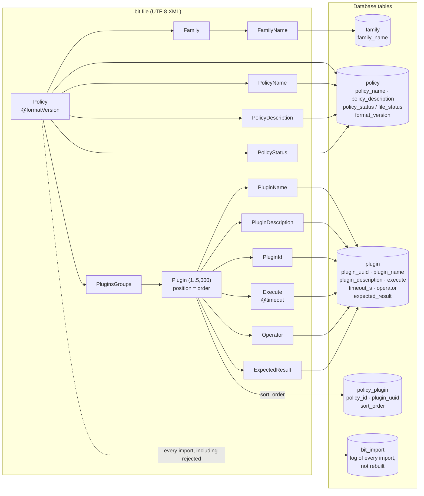

# .bit File Format & Schema Reference

Oct 19, 2026 · @Jason Liang

A `.bit` file is a UTF-8 XML document holding exactly one compliance Policy, one Family and its Plugins; the importer maps it one-to-one onto the `policy`, `family`, `plugin` and `policy_plugin` tables. Admins create, update or delete policies in the web UI or API, and server administrators by changing files in the policy folder (Technical Specification §4.1, §4.3).

## 1. Structure

The file has one root `<Policy>` with three metadata elements, one `<Family>` and one `<PluginsGroups>` holding one or more `<Plugin>` elements.



*Figure 1. The `.bit` element tree and the table each element lands in.*

Everything except plugin order maps to a column; order comes from the position of each `<Plugin>` inside `<PluginsGroups>`.

### 1.1 Canonical example

```xml
<?xml version="1.0" encoding="UTF-8"?>
<Policy formatVersion="1.0">
  <PolicyName>CIS Ubuntu 24.04 Level 1 - Server</PolicyName>
  <PolicyDescription>CIS Benchmark Level 1 controls for Ubuntu 24.04 servers.</PolicyDescription>
  <PolicyStatus>enabled</PolicyStatus>
  <Family>
    <FamilyName>CIS Ubuntu 24.04</FamilyName>
  </Family>
  <PluginsGroups>
    <Plugin>
      <PluginName>1.3.1.1 - Ensure AppArmor is installed</PluginName>
      <PluginDescription>Checks that the AppArmor package is installed.</PluginDescription>
      <PluginId>3f6c2a9e-8b1d-4e57-9a3c-2d7f0e6b1c48</PluginId>
      <Execute timeout="30"><![CDATA[
        dpkg-query -W -f='${Status}' apparmor 2>/dev/null
      ]]></Execute>
      <Operator>equals</Operator>
      <ExpectedResult>install ok installed</ExpectedResult>
    </Plugin>
  </PluginsGroups>
</Policy>
```

In the app this plugin is shown as **CIS Ubuntu 24.04 - 1.3.1.1 - Ensure AppArmor is installed**. Wrap `Execute` in `CDATA` so shell characters (`<`, `>`, `&`) need no escaping. If the host prints `install ok installed`, the `equals` comparison is true and the plugin returns 0 (PASS); if AppArmor is missing, stdout is empty and the plugin returns 1 (FAIL).

## 2. Element Reference

All elements are required unless marked optional; element names are case-sensitive in the canonical form.

### 2.1 `<Policy>` (root)

| Element / attribute | Parent | Occurs | Type | Constraints | Purpose in app |
| --- | --- | --- | --- | --- | --- |
| `Policy` | — | 1 | element | Root of the file | One compliance profile |
| `@formatVersion` | `Policy` | 0..1 | string | `1.0`; default `1.0` | Lets the parser handle future format changes |
| `PolicyName` | `Policy` | 1 | string | 1–128 chars, trimmed, unique across all files | Profile name shown in the compliance profile picker; natural key |
| `PolicyDescription` | `Policy` | 1 | string | 0–4,000 chars, plain text | Profile description shown in the app |
| `PolicyStatus` | `Policy` | 1 | enum | `enabled` or `disabled` (case-insensitive on input, stored lowercase) | Whether the profile can be selected and scanned |
| `Family` | `Policy` | 1 | element | — | The standard this policy implements |
| `PluginsGroups` | `Policy` | 1 | element | Must contain ≥ 1 `Plugin` | Container for the checks |

### 2.2 `<Family>`

| Element | Parent | Occurs | Type | Constraints | Purpose in app |
| --- | --- | --- | --- | --- | --- |
| `FamilyName` | `Family` | 1 | string | 1–128 chars, e.g. `CIS Ubuntu 24.04`, `Clustermax` | Names the standard; prepended to every plugin name in the UI |

### 2.3 `<PluginsGroups>` and `<Plugin>`

| Element / attribute | Parent | Occurs | Type | Constraints | Purpose in app |
| --- | --- | --- | --- | --- | --- |
| `Plugin` | `PluginsGroups` | 1..5,000 | element | Document order = display order | One check / line item |
| `PluginName` | `Plugin` | 1 | string | 1–255 chars; should start with the control reference, e.g. `1.3.1.1 - Ensure AppArmor is installed` | Line item in the standard; shown as `<FamilyName> - <PluginName>` |
| `PluginDescription` | `Plugin` | 1 | string | 0–4,000 chars | Explains what the check verifies |
| `PluginId` | `Plugin` | 1 | UUID | RFC 4122 string, lowercase; owned by exactly one policy (`plugin.owner_policy_id`, BIT015); policies that share a check use separate ids | Permanent key of the plugin; links results across versions |
| `Execute` | `Plugin` | 1 | string (CDATA) | 1–16,384 chars after trimming leading and trailing whitespace; POSIX `sh` script that prints the observed value on stdout | Command the runner executes on the endpoint |
| `Execute/@timeout` | `Execute` | 0..1 | integer | 1–600 seconds; default 60 | Per-plugin timeout on the agent |
| `Operator` | `Plugin` | 1 | enum | One of the 14 operators in §2.4; case-insensitive, stored lowercase | How the `Execute` output is compared with `ExpectedResult` |
| `ExpectedResult` | `Plugin` | 1 | string | 0–4,000 chars, trimmed; empty only with `empty` / `not_empty`; a number for numeric operators; a valid RE2 pattern for `regex` / `not_regex` | Value the output must match for the plugin to PASS |

### 2.4 `Execute` evaluation (Operator and ExpectedResult)

The `Execute` output (stdout) is compared with `ExpectedResult` using `Operator`; the comparison returns 0 = PASS, 1 = FAIL, anything else = ERROR.

| Operator | Compares as | PASS (0) when stdout… | Example `ExpectedResult` |
| --- | --- | --- | --- |
| `equals` | text | is identical to ExpectedResult | `install ok installed` |
| `not_equals` | text | differs from ExpectedResult | `disabled` |
| `contains` | text | includes ExpectedResult | `PermitRootLogin no` |
| `not_contains` | text | does not include ExpectedResult | `nullok` |
| `regex` | RE2 pattern | matches the pattern (multiline; use `^`/`$` to anchor) | `^MaxAuthTries\s+[1-4]$` |
| `not_regex` | RE2 pattern | does not match the pattern | `^\s*PermitEmptyPasswords\s+yes` |
| `eq` | number | = ExpectedResult | `0` |
| `ne` | number | ≠ ExpectedResult | `0` |
| `gt` | number | > ExpectedResult | `13` |
| `ge` | number | ≥ ExpectedResult | `14` |
| `lt` | number | < ExpectedResult | `91` |
| `le` | number | ≤ ExpectedResult | `90` |
| `empty` | presence | is empty | (leave empty) |
| `not_empty` | presence | is not empty | (leave empty) |

| Return code | Result | When |
| --- | --- | --- |
| 0 | PASS | Comparison is true |
| 1 | FAIL | Comparison is false |
| Anything else (stored as 2) | ERROR | Plugin timed out; exit code 126 or 127 (cannot run / not found); exit code ≥ 128 (killed by signal); stdout truncated at 64 KB; numeric operator but stdout is not a number; runner lost the plugin (`spool_overflow`, `runner_unavailable`); output over the caps |

- **Normalisation:** before comparing, CRLF becomes LF and leading/trailing whitespace is trimmed from both stdout and ExpectedResult. Comparison is case-sensitive.
- **Only stdout is compared.** stderr is stored as evidence. The command's own exit code does not decide PASS/FAIL (`grep` exiting 1 on no match is normal); only the cases in the table above give ERROR.
- **Numbers** are decimal integers or floats with an optional sign; the whole trimmed stdout must be one number.
- **Who evaluates:** the manager, not the agent, using the Operator and ExpectedResult recorded when the job was queued. The runner redacts output on the host before returning it (redaction patterns replace matches with `[REDACTED]`), and evaluation uses that redacted text. Write checks so that the value compared is never something the redaction patterns would hide.
- **Script rules:**
  - Read-only: no writes outside `/tmp`, no prompts, no changes to services or packages. **Exception:** `cmax-trigger collect` asks the ClusterMAX collector helper (Technical Specification §3.8) to run its fixed audit; the plugin itself still writes nothing.
  - Print only the observed value (e.g. `install ok installed`), not a sentence.
  - Mount-option checks must read the host's view (`findmnt --task 1` or `/proc/1/mountinfo`), because the runner's own `/tmp` and `/dev` are private.
  - Live firewall and audit rules are read with `bitscan-capread nft_ruleset` and `bitscan-capread audit_rules` where the helper is enabled; otherwise read the rule files on disk.
  - Commands that need uid 0 will fail; read the config files instead.
  - Never execute, source or `cd` into files or directories that non-root users can write; read them only as data. The runner can execute only system binaries.
  - Write-like commands are rejected at import (BIT102, §4.2), and the runner's sandbox blocks writes even if one slips through.

## 3. Database Mapping

The four catalog tables below are built from `.bit` files and can be rebuilt from them at any time (rows are upserted by natural key, never truncated). Each scan result keeps a snapshot of the command and expected result it ran with. Columns marked *system* are set by the importer, not the file.

### 3.1 `family`

| Column | Type | Null | Key | Source | Notes |
| --- | --- | --- | --- | --- | --- |
| `family_id` | BIGSERIAL | No | PK | system | Surrogate key |
| `family_name` | VARCHAR(128) | No | UNIQUE | `Family/FamilyName` | Shared by all policies of the same standard |
| `created_at` | TIMESTAMPTZ | No |  | system | First import time |

### 3.2 `policy`

| Column | Type | Null | Key | Source | Notes |
| --- | --- | --- | --- | --- | --- |
| `policy_id` | BIGSERIAL | No | PK | system | Surrogate key |
| `policy_name` | VARCHAR(128) | No | UNIQUE | `PolicyName` | Natural key used to upsert and to re-link profiles after rebuild |
| `policy_description` | TEXT | No |  | `PolicyDescription` | Default `''` |
| `policy_status` | ENUM(`enabled`,`disabled`) | No |  | `PolicyStatus` or admin override | Effective status |
| `file_status` | ENUM(`enabled`,`disabled`) | No |  | `PolicyStatus` | Always the file's value; restored when an override is cleared |
| `status_overridden` | BOOLEAN | No |  | system | `true` when an admin changed status in the UI; kept until an admin clears it |
| `family_id` | BIGINT | No | FK → `family` | `Family/FamilyName` (lookup) |  |
| `format_version` | VARCHAR(8) | No |  | `@formatVersion` | Default `1.0` |
| `version` | INTEGER | No |  | system | Starts at 1; +1 each time the file content changes |
| `source_file` | TEXT | No | UNIQUE | system | Path relative to `/var/lib/bitscan/bits/`; `deleted/<policy_id>` once deleted |
| `source_sha256` | CHAR(64) | No |  | system | Detects unchanged files |
| `deleted_at` | TIMESTAMPTZ | Yes |  | system | Set when the policy is deleted; the row is kept for history |
| `imported_at`, `updated_at` | TIMESTAMPTZ | No |  | system |  |

### 3.3 `plugin`

| Column | Type | Null | Key | Source | Notes |
| --- | --- | --- | --- | --- | --- |
| `plugin_uuid` | UUID | No | PK | `Plugin/PluginId` | Stable across versions |
| `family_id` | BIGINT | No | FK → `family` | parent `Family` |  |
| `owner_policy_id` | BIGINT | No | FK → `policy` | parent `Policy` | The one policy that defines this plugin |
| `plugin_name` | VARCHAR(255) | No |  | `Plugin/PluginName` |  |
| `control_ref` | VARCHAR(32) | Yes |  | parsed from `PluginName` | Leading `\d+(\.\d+)*`, used for natural sort; NULL if longer than 32 characters (BIT103 warning) |
| `plugin_description` | TEXT | No |  | `Plugin/PluginDescription` |  |
| `execute` | TEXT | No |  | `Plugin/Execute` | CDATA content with leading and trailing whitespace trimmed |
| `execute_sha256` | CHAR(64) | No |  | system | SHA-256 of `execute`; shows when a command changed |
| `timeout_s` | INTEGER | No |  | `Execute/@timeout` | Default 60, range 1–600 |
| `operator` | ENUM(`plugin_operator`) | No |  | `Plugin/Operator` | 14 values (§2.4), stored lowercase |
| `expected_result` | TEXT | No |  | `Plugin/ExpectedResult` | Trimmed; `''` only for `empty` / `not_empty` |
| `state` | ENUM(`active`,`retired`) | No |  | system | `retired` when no policy uses it |
| `updated_at` | TIMESTAMPTZ | No |  | system |  |

Derived for display (view `v_plugin`): `display_name = family_name || ' - ' || plugin_name`.

### 3.4 `policy_plugin`

| Column | Type | Null | Key | Source | Notes |
| --- | --- | --- | --- | --- | --- |
| `policy_id` | BIGINT | No | PK, FK → `policy` | parent `Policy` |  |
| `plugin_uuid` | UUID | No | PK, FK → `plugin` | `Plugin/PluginId` |  |
| `sort_order` | INTEGER | No |  | position in `PluginsGroups` | 1-based |

### 3.5 `bit_import` (log, not rebuilt)

| Column | Type | Notes |
| --- | --- | --- |
| `import_id` | BIGSERIAL PK |  |
| `file_name`, `file_sha256` | TEXT, CHAR(64) | What was imported |
| `policy_version` | INTEGER | `policy.version` after the import, if it succeeded |
| `mode` | `auto` / `manual` / `rebuild` | How it was triggered |
| `outcome` | `success` / `skipped` / `rejected` | `skipped` = automatic import of an unchanged file |
| `plugins_added`, `plugins_updated`, `plugins_retired` | INTEGER | Counts |
| `errors` | JSONB | List of `{line, element, code, message}` |
| `imported_by`, `imported_at` | BIGINT, TIMESTAMPTZ | NULL user = system |

### 3.6 Import algorithm (per file)

Inside one transaction (in a rebuild, one savepoint per file):

1. Upsert `family` by `family_name`.
2. Upsert `policy` by `policy_name` (or, if this server-folder file previously held a different name and that policy is not deleted, rename it in place); set `file_status` from the file, and `policy_status` too unless `status_overridden = true`; if the file hash differs from `source_sha256`, add 1 to `version`; clear `deleted_at` if the policy had been deleted.
3. For each `Plugin` in order: upsert `plugin` by `plugin_uuid` with `owner_policy_id` = this policy; set `state = active`.
4. Replace this policy's `policy_plugin` rows with the new list and `sort_order`.
5. Mark plugins no longer referenced by any policy as `retired`.
6. Commit. Any error rolls back the whole file. The new content is live immediately; jobs already queued keep the commands they were built with.

Then, in its own transaction, insert the `bit_import` row, so rejected imports are logged too.

## 4. Validation

A file is imported whole or rejected whole; every error is logged with its line number in `bit_import.errors`. Severity is given per rule; the number range does not imply severity. BIT001 and BIT002 (structure) are checked first; if either fails, the content rules are not run. Otherwise every failing rule is reported. Codes `BIT006`, `BIT009` and `BIT018`–`BIT020` are retired and not reused.

### 4.1 Rules

| Code | Rule | Severity |
| --- | --- | --- |
| `BIT001` | Well-formed XML, UTF-8, ≤ 5 MB, no DTD or external entities | Reject |
| `BIT002` | Uses the canonical element names, each required element present once, in the order shown in §2 | Reject |
| `BIT003` | `PolicyStatus` is `enabled` or `disabled` | Reject |
| `BIT004` | `PluginId` is a valid UUID | Reject |
| `BIT005` | `PluginId` unique within the file | Reject |
| `BIT007` | `PolicyName` already imported from a different file in the server folder that still exists. If the old file is gone, the policy moves to the new file and the move is audit-logged. A policy that lives in `uploaded/` moves to the server folder instead (the server folder wins; Technical Specification §4.1). Does not apply to uploads, which are always stored under the policy's own id. | Reject |
| `BIT008` | `Execute` is empty or > 16,384 chars | Reject |
| `BIT010` | `Operator` missing or not one of the 14 operators | Reject |
| `BIT011` | `ExpectedResult` element missing | Reject |
| `BIT012` | Numeric operator (`eq`…`le`) with a non-numeric `ExpectedResult` | Reject |
| `BIT013` | `regex` / `not_regex` with an invalid RE2 pattern | Reject |
| `BIT014` | Empty `ExpectedResult` with any operator other than `empty` / `not_empty`, or non-empty with them | Reject |
| `BIT015` | `PluginId` already owned by a different policy (`plugin.owner_policy_id`) that is not deleted and still lists it. A plugin whose owner is deleted, or no longer lists it, is claimed by the importing policy. | Reject |
| `BIT016` | `@formatVersion` is not a supported version (`1.0`) | Reject |
| `BIT017` | Any value outside its limit in §2 (other than `Execute` length, which is BIT008): text length, `Execute/@timeout` outside 1–600, or more than 5,000 plugins | Reject |
| `BIT101` | `PluginName` has no leading control reference | Warn |
| `BIT103` | The leading control reference is longer than 32 characters, so it is not stored for sorting | Warn |
| `BIT102` | `Execute` contains a write-like or state-changing command (§4.2) | Reject |

### 4.2 BIT102 in detail

`Execute` is split into tokens with a POSIX `sh` lexer (not a substring search), and the importer rejects:

- a command word that is one of `rm`, `mv`, `cp`, `tee`, `dd`, `chmod`, `chown`, `chgrp`, `truncate`, `ln`, `install`, `mkfs`, `mount`, `umount`;
- `sed` with `-i` or `--in-place`;
- `apt` or `apt-get` with `install`, `remove`, `purge`, `upgrade`, `full-upgrade`, `dist-upgrade` or `autoremove`;
- `dpkg` with `-i`, `-r`, `-P`, `--install`, `--remove`, `--purge` or `--configure`;
- `systemctl` with `start`, `stop`, `restart`, `reload`, `enable`, `disable`, `mask`, `unmask`, `kill`, `isolate` or `set-property`;
- output redirection (`>`, `>>`, `>|`) to any path other than `/dev/null`, `/dev/stdout`, `/dev/stderr` or `/tmp/…`;
- running other code: `.` or `source`, `eval`, `exec`, `xargs`, `find` with `-exec`, `-execdir`, `-ok` or `-okdir`, `sh`, `bash` or `dash` given a script file instead of `-c`, and `sh -c`, `bash -c` or `dash -c` whose script contains a command substitution (`$(…)`, backticks) or process substitution (`<(…)`).

Read-only uses such as `apt-cache policy`, `apt list --installed`, `find … -perm`, `systemctl is-enabled` and `2>/dev/null` are allowed. Published CIS audit scripts often use `xargs` or `find -exec`; rewrite those with `find … -print` and a `while read` loop. The canonical example in §1.1 and a corpus of common CIS commands are must-pass test cases. BIT102 is a safety net; the runner's sandbox is the real control.
